# CROATOAN gate beauty corner: build log

Target: `art/levels/roanoke/croatoan-gate.jpg`. Unreal Engine 5.8.4, Lumen (software; this Shadow PC's NVIDIA 565.90 driver crashes with hardware ray tracing), volumetric fog.
Assets: free Quixel Megascans from Fab (Standard License, $0 for Unreal): Old Wooden Log x2, Old Wooden Beam, Soil Mud, Wild Grass, Military Trenches Ground Mud. The CROATOAN carving and the scratched 1587 colonists' names are our own texture.
Project: `C:\LETHE` (map `L_Beauty_CroatoanGate`, script `Scripts/build_beauty_gate.py`).

## Round 1 · 2026-10-29

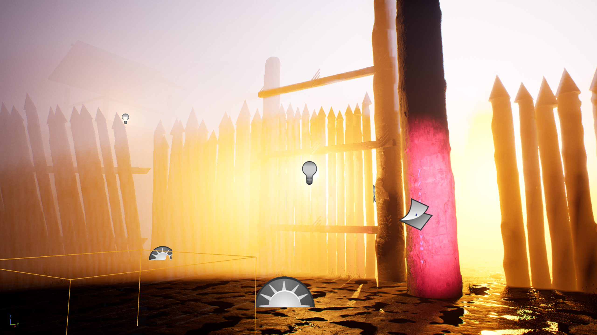

Working: real scanned bark and cracks on every log; wet mud with puddles in the low spots; composition close to the reference (bastion left, lashed pole gate with lantern, dark gatepost, stripped post right).

Differences from the reference, to fix in round 2:
1. Fog glows yellow-white; the reference is a dark blue-grey night. Warm light behind the wall floods the fog, and the fog scatters strongly toward the camera.
2. CROATOAN reads vertically: the carving decal is rotated 90°.
3. Post reads magenta (violet UV beam mixed with orange light); should be pale wood under a cool violet beam.
4. Editor icons (light bulbs, fog sprite, a volume outline) were captured in the render.
5. Still the old 24 mm camera; the 35 mm low-angle camera from the brief applies from round 2.
6. No rocks or weeds yet; tall grass reads too sparse.

## Round 2 · 2026-10-29

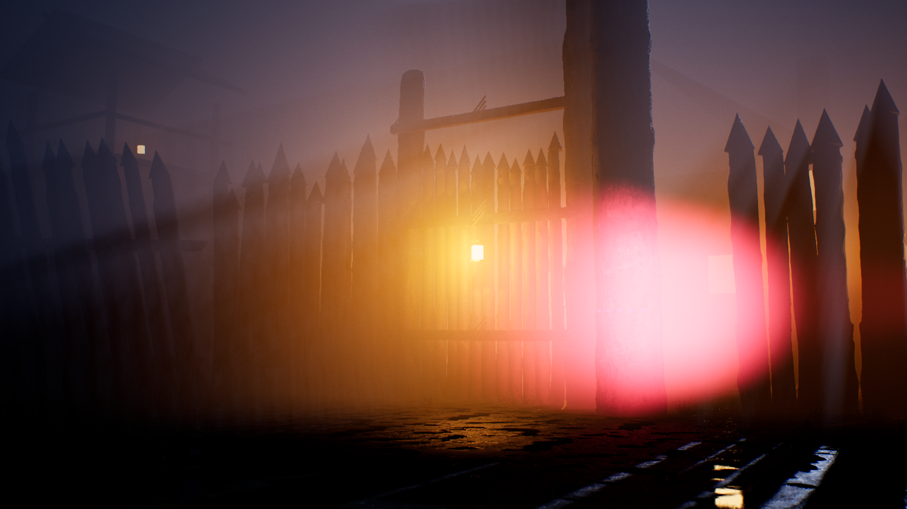

Fixed since round 1: night mood (dark blue-grey fog, less forward glare), 35 mm low-angle CineCamera with shallow depth of field, lanterns limited to ~8 m, carving decal rotated to read horizontally, editor icons removed, every exposure saves.

Differences from the reference, to fix in round 3:
1. A large pink blur hides the CROATOAN post and its carving: the UV lantern's light source now sits inside the 35 mm frame. Move it out of frame to the right and soften its glow in the fog.
2. The stripped post must read as the brightest, palest object; it is currently hidden.
3. Fog leans mauve; the reference is colder blue-grey.
4. Ground foreground is good (wet mud, reflections); grass and weeds barely read.
5. Warm glow behind the gate is still larger than the reference's small lantern points.

## Round 3 · 2026-10-29

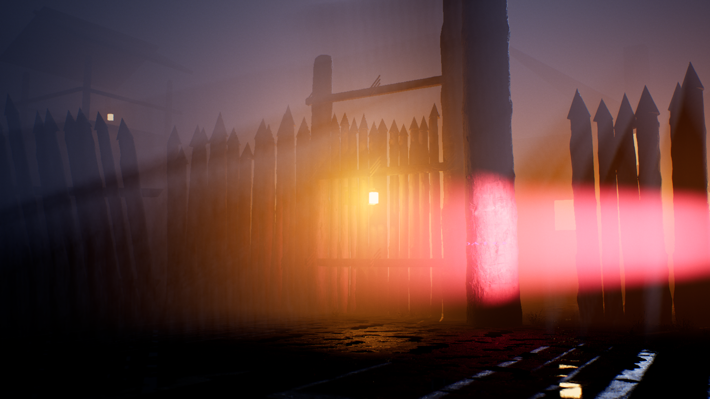

Fixed since round 2: the UV lantern is out of frame; colder fog; dimmer gate lantern.

Differences from the reference, to fix in round 4:
1. The UV beam reads as a wide, out-of-focus pink band across the frame; the reference has a tight violet-blue beam landing on the letters.
2. The carving decal's width and height were swapped by the rotation, so CROATOAN is stretched about 2.5 m round the post and only a sliver shows.
3. The stripped post doesn't read pale: nothing lights it from the front. The reference post is the palest, best-lit object.
4. Grass, weeds and rocks still barely read.

## Round 4 · 2026-10-29

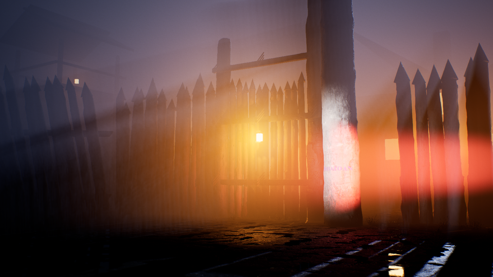

Fixed since round 3: the stripped post now reads as the palest object (cool fill from out of frame); CROATOAN is legible at 1.5 m; deeper focus.

Differences from the reference, to fix in round 5:
1. The UV beam renders red-orange instead of violet: the light colour channels were set in the wrong order.
2. CROATOAN is too small in frame: the camera is ~13 m from the post, where the reference stands close. Move to ~8 m, keeping the bastion and gate in shot.
3. Rocks, weeds and tall grass still to add.

## Round 5 · 2026-10-29

No image: the editor throttled itself to ~3 fps while it was not the front window and every capture timed out. Fixed in `Config/DefaultEditorPerProjectUserSettings.ini` (`bThrottleCPUWhenNotForeground=False`). Its changes (violet beam colour, closer camera) went into round 6.

## Round 6 · 2026-10-29

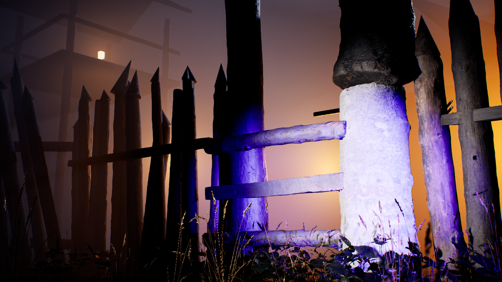

New since round 4 (design-session review applied): irregular axe-hewn wedge tips, some broken flat; trunks 25-45 cm x 3.5-4.5 m with random lean and spin, a few gaps; lashed cross-rails; the entrance rebuilt as a narrow gap between two great posts barred with heavy timbers (the CROATOAN post is now the right-hand post itself), bark left on above the stripped band; carved-normal on the letters; 8 more free Megascans (3 rocks, curbside weeds, nettle, dry grass, wheat grass, dead shrubs) crowding the wall foot; watch platform with its lantern in the fog, top left as in the reference.

Differences from the reference, to fix in round 7:
1. Camera too close and too low: the post fills the frame and is cropped; the flanker and gate are mostly out of shot. Go to 40 mm at ~8.6 m, eye height.
2. Violet floods the rails and the left gatepost; the UV beam should be a tight spot on the letters only.
3. CROATOAN barely reads: the violet glow washes out the dark cuts. Darker, deeper grooves; less UV emission.
4. The bark band above the stripped section bulges like a cap; it should be flush.
5. A floating lantern hook rod; the warm glow behind the right wall is too strong.

## Round 7 · 2026-10-29

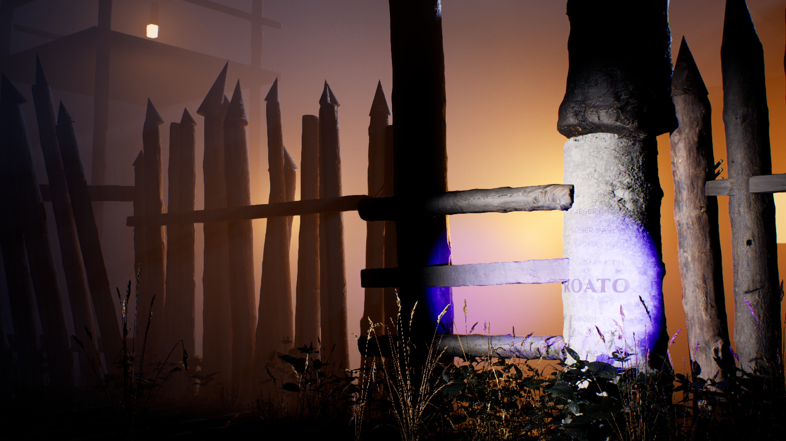

Fixed since round 6: 40 mm framing with the watch platform, flanker, barred gap and post all in shot; the UV beam is a tight spot; the later names (MARGERY HARVIE, ROGER BAYLYE, THOMAS WARNER…) read on the post.

Differences from the reference, to fix in round 8 (with the design session's round 6 review):
1. CROATOAN shows only "ROATO": it wraps past the visible face, and a gate bar crosses the 1.5 m line. Turn the carving to face the camera, use condensed Roman capitals (~11 cm) on a wider post, move the bars clear.
2. The cuts read lavender, not dark: remove the UV glow from the grooves.
3. The stripped band reads as white plaster; it should be cream-to-tan wood with grain.
4. Palisade: thicker trunks (35-55 cm) set tight with no daylight; rails behind the trunks, not in front.
5. Orange haze behind the wall; the reference is a cool blue-grey night with small warm points.

## Round 8 · 2026-10-29

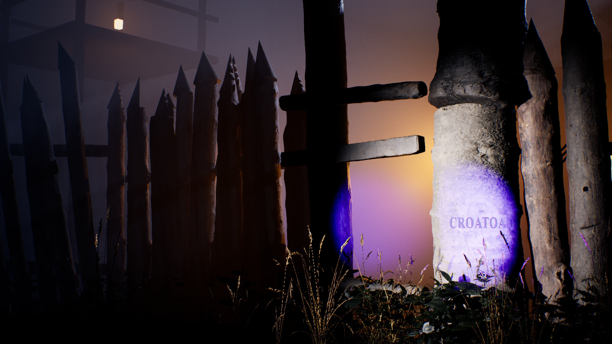

Fixed since round 7: CROATOAN reads in dark, deep Roman capitals at 1.5 m with the later names round it; the carving faces the camera on a wider post; stripped band is pale tan wood with grain; trunks 35-55 cm set tight with rails behind; the orange is mostly gone.

Differences from the reference, to fix in round 9:
1. The final N is clipped at the post's edge: narrow the word slightly and centre it on the visible face.
2. The UV spot also lights the left gatepost through the gap: tighter cone.
3. Gate bars stop short of the post.
4. The bark band above the stripped section still bulges like a cap (the scan used has a knot there).
5. Warm glow behind the gap still a little large.

## Round 9 · 2026-10-29

Fixed since round 8: flush bark band above the stripped section; gate bars reach the post; tight UV spot; smaller warm glow behind the gap.

Differences from the reference, to fix in round 10 (final pass for now):
1. The last N is still clipped: turning the carving to -31° moved it the wrong way. Turn to about -12°.
2. The letters look printed (design-session review): cut them by hand: each letter its own size, tilt and baseline, uneven spacing, V-grooves with chipped edges, wood grain visible inside the cuts.

## Round 10 · 2026-10-29

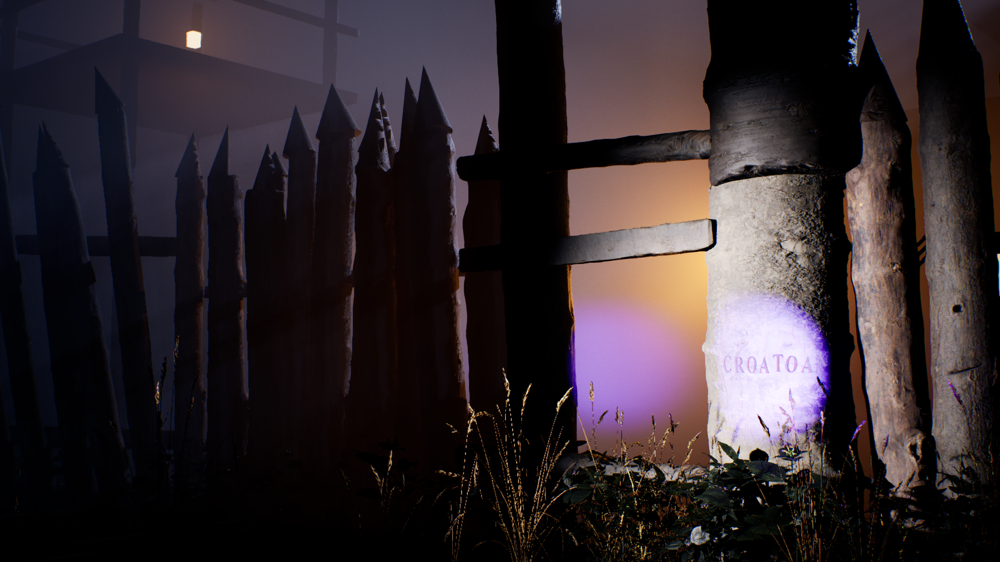

New: CROATOAN cut by hand: each letter its own size, tilt and baseline, uneven spacing, V-grooves with chipped edges, wood grain inside the cuts (`tools/make_carving_mask.ps1`). The scene script is in `tools/build_beauty_gate.py`.

Still to fix (round 11): the final N touches the post's edge; the cuts read lighter than in round 9.

## Round 11 · 2026-10-29

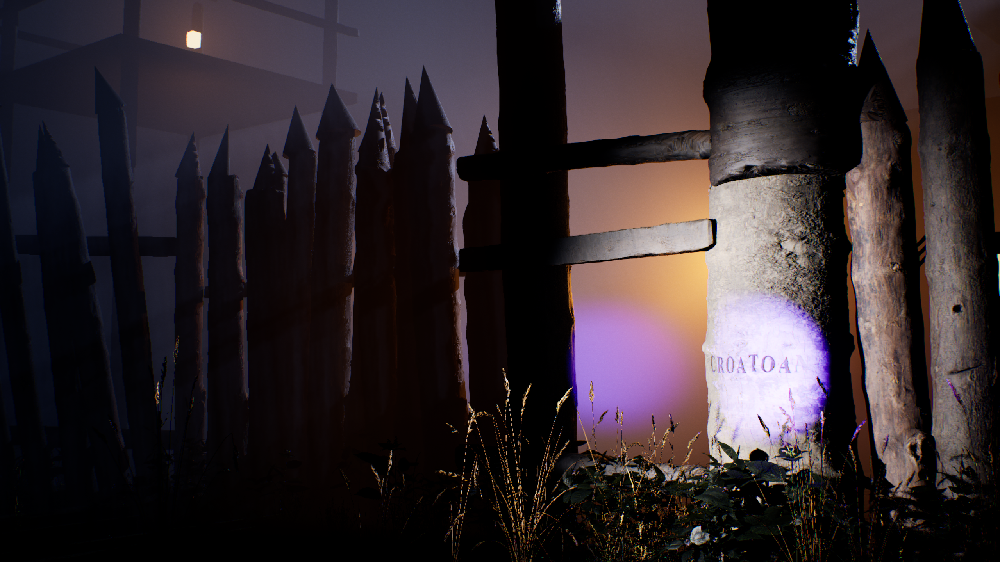

Darker cuts with grain; turning the carving moved the word left, but it was simply wider than the visible face: C at the left edge, N still clipped.

## Round 12 · 2026-10-29 · first beauty pass done

All eight letters of CROATOAN read: hand-cut Roman capitals, 1.5 m up the stripped right-hand post, in the violet beam, with the later names scratched round them. Word narrowed 20% to sit on the visible face.

Agreed with the design session: this closes the first beauty pass. A second pass will come with Nysa (MetaHuman) in the shot. Known items for that pass: the warm glow behind the gap is still a little large; the left gatepost catches some violet; Nysa and her lantern replace the off-screen UV source.

## Sketch match · round 1 · 2026-10-30

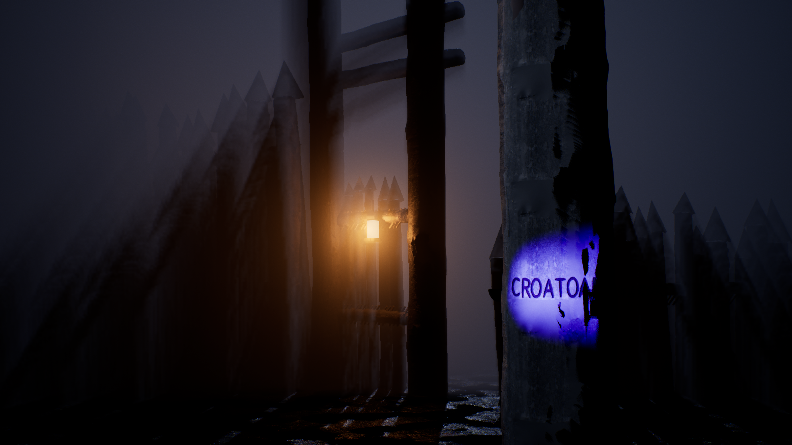

Scene rebuilt against `art/levels/roanoke/croatoan-gate.jpg`. Render 2560x1440, 35 mm at eye height 1.6 m, exposure -2 EV.

New this round:
- Moonlit blue-grey fog. Warm light only from the gate lantern, the tower lantern and the house windows. UV beam aimed at the post only.
- Wet mud ground with puddles, a few stones, small tufts at stake feet only (no tall grass).
- Thicker CROATOAN post (76 cm) with a tall stripped panel. Letters are 10 cm high at 1.5 m. No cross, no extra names.
- Gate between two posts with lashed crossbars, rope-lashed rails on the palisade, stakes of uneven height, lean and girth.
- Axe-cut stake points built from our own faceted meshes (`tools/make_hewn_tips.py`), not cones.
- Watchtower with shingle roof, rails and lantern. Timber-frame house with chimney and two lit windows.

Still far from the sketch (round 2):
1. Composition: the two gateposts stand like a tall ladder in mid-frame. The palisade on the left fills too much of the frame. The tower and house are lost in the fog.
2. Fog is too thick and shows streaky shadow shafts. It needs to be thinner near the camera so the background shapes read.
3. The UV pool is a hard, saturated blue oval. It should be a softer violet wash.
4. The stripped panel reads grey, not pale wood. The last N is clipped at the post edge, and the letters still look too even.
5. Stake points are too regular and slightly wider than the log, so they read as arrowheads.
6. The foreground mud is too flat and empty.

## Sketch match · round 2 · 2026-10-30

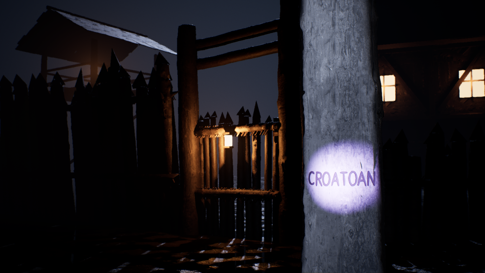

Changes from the round 1 review (exposure -0.5 EV):
- A. Camera 4 m from the post, looking along one wall that recedes left. The gate opening with its lantern is centre-left. The right gatepost stands close to the CROATOAN post, and a short run of palisade continues behind it to the right. The lintels now span only the opening.
- B. Every letter is cut differently: height ±15%, tilt ±4°, wandering baseline, its own stroke weight, uneven spacing. All 8 letters sit on the panel with margin. A few dry cracks run with the grain.
- C. UV beam is violet-white with a soft edge, held off-axis from the left, about 1.5x the width of the word.
- D. The post uses its own log scan (the old mismatch gave the "grey paint" look). The panel grain now comes from one continuous strip of the scan, with no repeated tiles. A torn bark rim with depth runs round the panel edge.
- E/F. Fog shadow shafts are off. The sky and fog glow are lifted, so the watchtower (top left) and the house with two lit windows (top right) read as dark shapes.
- G. Thicker rope lashings on the gate crossbars beside the lantern.
- Stake points no wider than the log, shorter and more uneven.

Still to fix (round 3):
1. The fog went too thin. The background is too crisp, and the tower and house look too near. Bring back a light, even haze that grows with distance, and push the tower and house further back or make them smaller.
2. The tower roof reads as one flat slab. It needs visible shingle rows and a darker underside.
3. The post bark edges are not dark enough against the pale panel. Darken the bark and make the rim stand out more.
4. The mud foreground shows a regular tile pattern in the puddles. Break it up with the mud decals and more stones.
5. At this distance the letters still look a little even. The variation could go further.
6. The house windows are a little too bright. Tone them down so they glow through the haze.

## Sketch match · round 3 · 2026-10-30

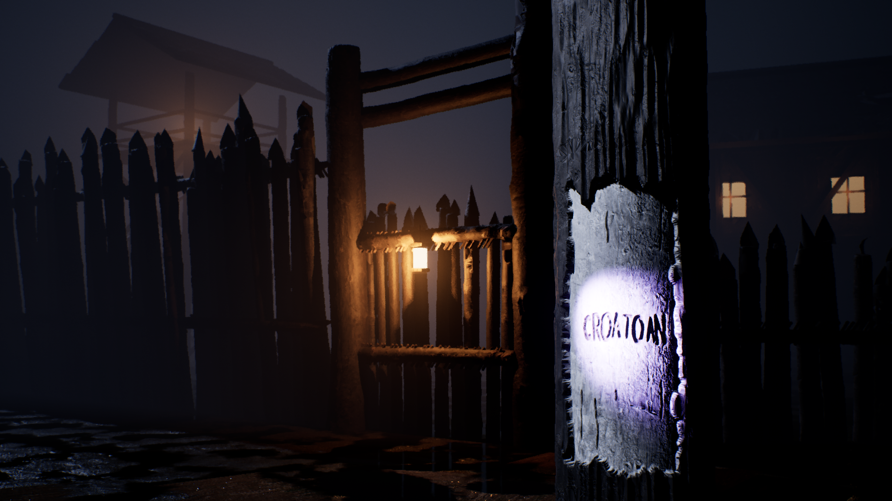

UV light off (test for H): the word still reads from the grooves alone, under the moon and the lantern.

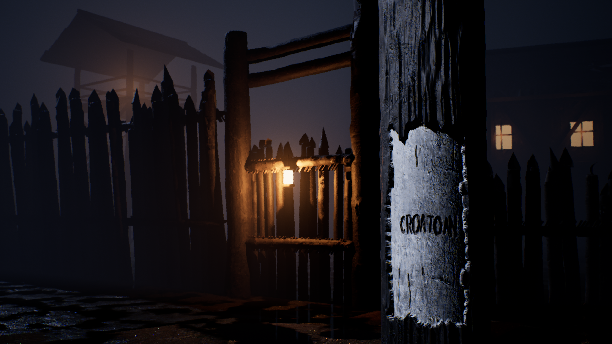

Changes from the round 2 review (exposure -0.5 EV):
- H/I. The CROATOAN post is now real geometry (`tools/make_panel_mask.ps1` writes the mesh), not a decal:
  - Dark, deeply furrowed bark all round the post.
  - One stripped panel, about 54 x 120 cm, centred at 1.5 m and sunk 2.5 cm below the bark, so the torn bark edge shows its thickness.
  - CROATOAN cut as V-grooves about 1.1 cm deep (letters 10 cm high, each one different), with darker raw wood inside the cuts. The letters carry no colour; they read from shadow.
  - The panel and bark share the log scan's grain strip, with no repeated tiles.
- J. UV beam: three overlapping soft lobes of different widths, slightly mis-aimed, so the pool has an uneven edge. It is held up and to the left, so it rakes across the grooves. An IES profile was tried but pointed off the light's axis in UE 5.8, so it is not used.
- K. Stakes are 20-32 cm and narrower at the point. Each point is 3-4 flat axe planes at random angles (`tools/make_hewn_tips.py`). The moon now comes from behind-left, so the stake edges pick up a rim.
- M. Mud varies at large scale, so the puddles no longer repeat as evenly. Hand-placed puddles on the approach catch the gate lantern, plus mud patches, two cart ruts and more stones.
- N. Tower: two storeys with X braces, a ladder, floor beams, a railed walk, a pitched shingle roof with 80 cm overhang and a dark underside, and a lantern. Set back in the fog.
- The house is pushed back and its windows toned down. A light haze returns with distance.

Assets: only the free Quixel Megascans already in the project (Fab Standard License, free for commercial use in Unreal): Old Wooden Log x2, Old Wooden Beam, Soil Mud, Military Trenches Ground Mud, Small Stones Pack, Scatter Rocks 03/06, plus grass and weeds. The post, stake points, tower and house are our own geometry.

Still to do (round 4):
1. L: Megascans bark, roof shingles and a timber-frame building would beat the hand-built tower roof and house. Adding them needs the project owner's Fab sign-in, so it is waiting on that.
2. The N of CROATOAN sits close to the panel's right edge. Give it a few more cm of margin.
3. At this distance the letters read a little thin. Cut them deeper and wider.
4. The tower roof still reads as a plain slab through the fog.
5. The far-left foreground mud still shows some repeat.

## Full scene · 2026-10-31

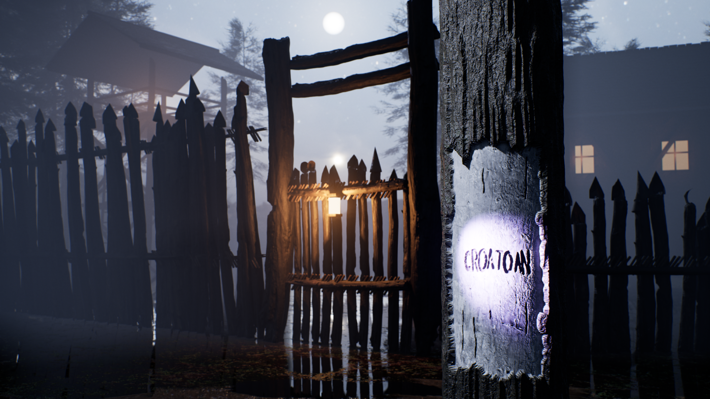

One complete shot of the CROATOAN gate against the sketch (`art/levels/roanoke/croatoan-gate.jpg`), rendered with Movie Render Queue: Lumen, 32 temporal samples, 64 warm-up frames, 2560x1440. Path Tracer was not used, because hardware ray tracing is off on this PC since the GPU driver crash.

In frame:
- Photographed moonlit night sky with the moon above the gate.
- Real fir trees in layered height fog.
- Palisade and gate built from a scanned trunk.
- Wet mud with puddles reflecting the gate lantern and the moon.
- Watchtower with lantern, house with two lit windows.
- The carved CROATOAN post: bark, stripped panel and V-cut letters as real geometry.

**Stand-ins and what's missing**
- **Nysa is not in the shot.** Her spot by the post is left clear. Free MetaHuman hair and clothing can't give her long dark curly hair, a fitted coat and the raised torch, so she waits for her own MetaHuman.
- The tower, house, gate lantern, hewn stake points and shingle roofs are our own simple geometry, textured with scanned wood. No free scanned versions exist.
- The moon disc and halo are drawn into the sky material; the sky behind them is the photograph.

**Assets and licences**
- Poly Haven, CC0 (public domain, no attribution needed, no AI restriction):
  - `rogland_moonlit_night`: sky
  - `fir_tree_01`: forest
  - `dead_tree_trunk`: stakes, rails, gateposts, tower legs
  - `knotted_pine_bark`: post bark
  - `brown_mud_leaves_01`: ground
  - `rock_moss_set_01`: stones
- Downloaded but not used yet (CC0): `bark_brown_02`, `brown_mud_02`, `forest_ground_04`, `dead_tree_trunk_02`, `tree_stump_01`, `Lantern_01`, `wooden_lantern_01`, `qwantani_night_puresky`.
- Quixel Megascans still in frame (Fab Standard License, marked "no AI usage"), to be replaced with CC0 next:
  - Old Wooden Log grain: stripped panel and cut wood
  - Old Wooden Beam: rope lashings, beams, house walls, shingles
  - Military Trenches mud decal: mud patches and ruts
  - Grass tufts
- Nothing bought. No Medieval Village sample.

**Differences from the sketch**
1. No Nysa (see above).
2. The light is cooler and flatter. The sketch has deeper blacks, a warmer gate lantern and a lit tower platform.
3. Tower and house read as plain shapes in the fog. They need real timber detail, or scans.
4. The stake points still read a little like arrowheads.
5. CROATOAN still looks somewhat even, and the panel is cleaner than the weathered one in the sketch.
6. The scanned Poly Haven lanterns are not yet swapped in for the gate and tower lanterns.

## Full scene · round 2 · 2026-10-31

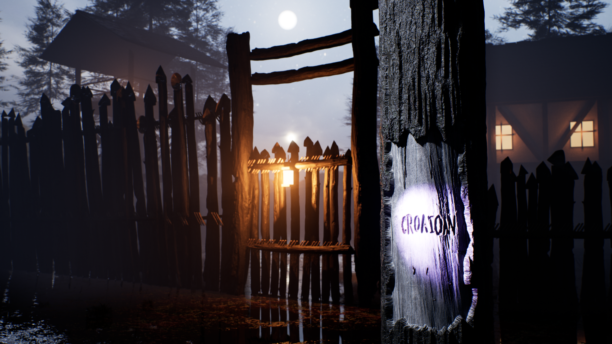

Sydra's six fixes after the first full scene (Movie Render Queue, Lumen, 32 samples, 2560x1440):
1. **Panel:** now the post's own wood with the bark peeled away. It's sunk 3.5 cm with a thick, torn bark edge (bigger tears, less fringe), in silver-grey weathered wood with vertical grain and cracks (Poly Haven `rough_wood`). No hard white.
2. **Letters:** cut deeper and more unevenly. Each letter has its own size, tilt and baseline, and the straight strokes have knife nicks at their ends. The cuts show darker raw wood (`fine_grained_wood`), with the violet beam raking from the upper left.
3. **Stakes:** whole scanned trunks (Poly Haven `dead_tree_trunk`), 20-32 cm, with uneven heights and leans. The axe points sit full width and start inside the trunk, and some stakes are snapped off.
4. **House:** thick thatched roof (`thatch_roof_angled`), plaster daub between the timbers (ambientCG `Plaster001`), framed windows, chimney. Both buildings sit deep in the fog.
5. **Light:** dimmer moon and sky fill, so the foreground goes darker. Warm gate lantern, tower lantern and house windows glow into the fog and onto the mud. More contrast, soft violet pool.
6. **Quixel "no AI" items:** all replaced in frame:
   - rope → ambientCG `Rope001`
   - beams → the scanned trunk
   - grass and weeds → Poly Haven `grass_medium_01`, `weed_plant_02`
   - Quixel mud decals → removed

Assets in frame (all CC0, free, nothing bought):
- Poly Haven: `rogland_moonlit_night`, `fir_tree_01`, `dead_tree_trunk`, `knotted_pine_bark`, `rough_wood`, `fine_grained_wood`, `thatch_roof_angled`, `wood_trunk_wall`, `brown_mud_leaves_01`, `rock_moss_set_01`, `grass_medium_01`, `weed_plant_02`
- ambientCG: `Rope001`, `Plaster001`

Our own geometry: the carved post, axe-cut stake points, tower, house frame, gate lantern. Nysa is out for now, as Sydra asked.

Still different from the sketch:
1. Many stake points still read a little arrow-like, and a few snapped stakes show flat round tops.
2. The tower is still a plain shape; it needs posts and a railing that read through the fog.
3. The foreground mud is very dark and empty. The sketch has lit puddles and stones close to the camera.
4. The letters are better but still a little regular. The sketch's are deeper and wider.
5. The Poly Haven lanterns are not yet swapped in for the gate and tower lanterns.

## Spec match · round 1 · 2026-10-31

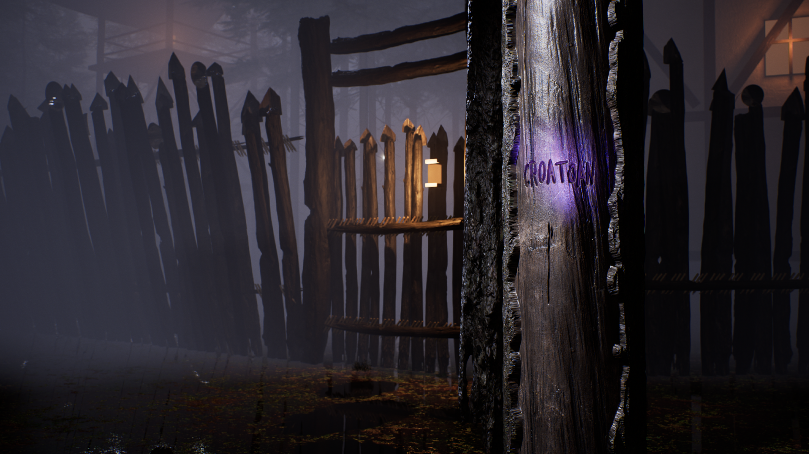

Rebuilt to `art/levels/roanoke/croatoan-gate-spec.md` and measured with `tools/measure_frame.ps1`: the spec's brightness bands plus 24 named regions, boxes as frame fractions. Run on the painting itself, the script reproduces the spec's numbers (average #272427 against the spec's #282527), so the two columns below are measured the same way.

Rendered with Movie Render Queue (Lumen, 32 samples, 2560x1440). Everything in frame is CC0 (Poly Haven, ambientCG) or our own geometry; nothing was bought. Nysa is still out, so her space (x 0.505-0.65) is clear.

**1. Brightness**

| Band | Painting | Render |
|---|---|---|
| 0-20% | 71.1% | 72.7% |
| 20-40% | 27.5% | 23.7% |
| 40-60% | 1.2% | 2.8% |
| 60-80% | 0.2% | 0.8% |
| 80-100% | 0.0% | 0.1% |
| Average | #272427 | #2B262C |

**2. Regions** (average colour; within about ±15 RGB of the painting counts as close)

| Region | Painting | Render | |
|---|---|---|---|
| Sky, top left | #494A59 | #383947 | darker |
| Sky, top centre | #454955 | #35323C | darker |
| Sky, top right | #454755 | #36292B | darker, warmer |
| Ground mist, left | #39393D | #31323F | close |
| Through the gate gap | #1B1918 | #5E4D4D | **too bright**: fog lights the firs behind the gate |
| Watchtower roof | #46454F | #524A56 | close |
| Tower lantern | #845D46 | #5B505B | missed: the lantern sits off its spot (0.19, 0.14) |
| Left palisade stakes | #202022 | #31303C | slightly bright |
| Gate lantern core | #BF8446 | #D39655 | close |
| Gate lantern halo | #372618 | #705544 | halo too wide and bright |
| Gate crossbeams | #1D1C1C | #56515E | **too bright**: fog behind them |
| Dark second post | #0E0E10 | #221F20 | slightly bright |
| Post bark | #110F0E | #050405 | slightly dark |
| Post left edge (UV) | #54426A | #6B5B63 | close, less violet |
| Stripped panel, upper | #393131 | #463F46 | close |
| Stripped panel, lower | #372C28 | #211B1B | darker |
| Panel inside UV pool | #564583 | #3C333A | **less violet** |
| Letters band | #584A7B | #615075 | close |
| Foreground mud | #262426 | #110E0F | **too dark** |
| Middle mud | #292829 | #2C2B35 | close |
| Puddle reflection | #201B17 | #1A1311 | close |
| House wall, right | #403C41 | #3F2E2D | close, warmer |
| House window | #5D4237 | #211F26 | missed: our window lands at about (0.97, 0.08), not (0.85, 0.20) |
| Right palisade stakes | #141312 | #0E0D11 | close |

**What changed from round 2:**
- Low-key overcast night: no moon, sky dimmed, overall exposure matched to the painting.
- Camera horizon at y 0.55.
- Gate lantern moved to (0.537, 0.38) with an amber core.
- Lavender UV (#7961D9) from Nysa's hand position (0.645, 0.505).
- The whole front face of the post is stripped, with CROATOAN at y 0.40-0.445 and a wide, clear T. No extra names.
- A dark full-bark second post at x 0.58-0.645.
- Left palisade leans outward 12°, with rails at the spec heights.
- Taller right palisade.
- Gate leaf and rope rails at the spec heights.
- A low mist bank on the left.
- Neutral grade (the blue shadow tint is gone).

**Still to fix (round 2):**
1. The gate gap and crossbeams are lit grey by fog, where the painting is dark. They need dark structures right behind the gate.
2. The watchtower and its lantern sit too high and left. The house window lands near the top-right corner.
3. The UV pool is too pale. The painting's is a stronger violet (#564583).
4. The foreground mud near the camera is too dark and plain. It needs wet highlights and stones.
5. The stake points still read arrow-like, and there is no barrel at the right.

## Painting match · round 1 · 2026-10-31

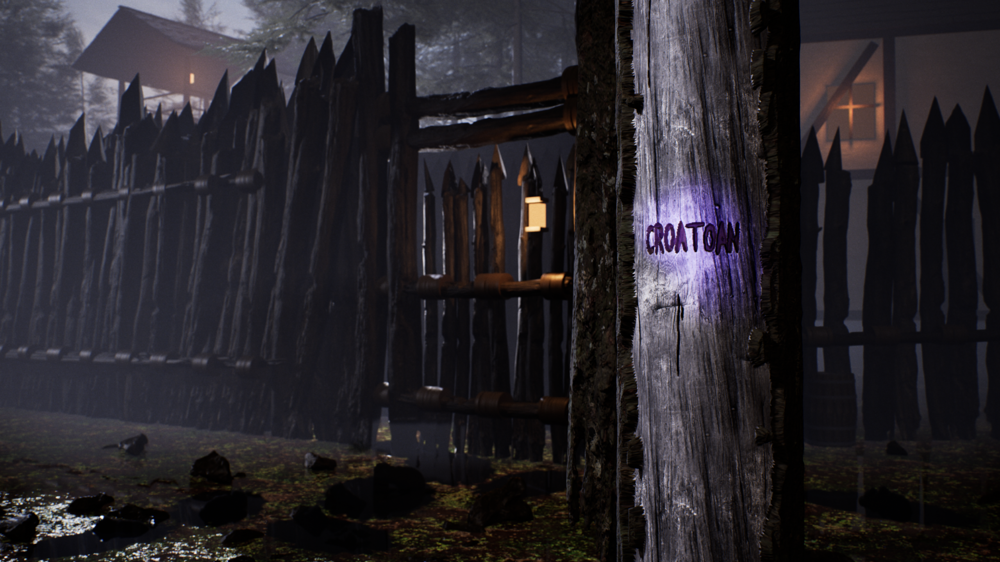

Judged against `art/levels/roanoke/croatoan-gate.jpg` by eye first: a 50% overlay, an edge map and a side-by-side for every test render (`tools/compare_frame.ps1`, new), then the numbers (`tools/measure_frame.ps1`). Six test renders this round; this is the last. Movie Render Queue, Lumen, 32 samples, 2560x1440, exposure +2.25 EV (was +1.9; the scene is less foggy now, so it needed a little more). Everything in frame is CC0 (Poly Haven, ambientCG) or our own geometry; nothing was bought. Nysa is still out.

**What changed from spec match round 1:**
- **Wall at the painting's scale.** Left palisade of 35-50 cm trunks packed with overlap, a second row behind on the joints (no fog through the wall), leaning 14° toward the gate so it reads "/" as in the painting, two thick rails with rope bands. A massive gatepost pair. Right palisade: tall, separate, upright stakes, set back.
- **No more arrowheads.** The stake points were short meshes that `place_between` stretched sideways. They are now long (1.5-2.3x the trunk), narrower than the trunk, and mostly the trunk's own dark wood.
- **CROATOAN post.** A 70 cm post, near-black bark, the stripped face pale by contrast (a new contrast control on the pale wood). Wider, deeper cuts (2 cm), steadier capitals, a wide T, at the painting's height (y 0.42). The torn bark edge is bark now, not bright saw teeth. No extra names.
- **Dark gate gap.** Two thick crossbeams moved down to y 0.17-0.25 with rope bands, and dark stakes plus a dark backing right behind the gate where the sightlines through it land.
- **Positions by the camera, not by guesswork.** The build script now projects frame positions into the world: tower lantern at (0.19, 0.14), house window at (0.85, 0.20), barrel at x 0.81-0.85, y 0.67-0.80, stones and puddles where the camera sees the ground (it starts ~6 m out; earlier stones and puddles were all out of frame).
- **Wet mud** with glints from a low cool light beyond the foreground.
- **Painterly.** Sharpening off, softer bloom, film grain 0.35, f/2.8 so the gate, tower and house soften slightly while the post stays sharp. Less fog on the wall, a low mist bank only.

**1. Brightness**

| Band | Painting | Render |
|---|---|---|
| 0-20% | 71.1% | 76.5% |
| 20-40% | 27.5% | 18.1% |
| 40-60% | 1.2% | 3.7% |
| 60-80% | 0.2% | 1.7% |
| 80-100% | 0.0% | 0.2% |
| Average | #272427 | #28252A |

Edge agreement (edges within 4 px of an edge in the other image): spec match round 1 38.7%, this round **49.4%**.

**2. Regions** (average colour; within about ±15 RGB of the painting counts as close)

| Region | Painting | Render | |
|---|---|---|---|
| Sky, top left | #494A59 | #43434F | close |
| Sky, top centre | #454955 | #36363F | darker: fir silhouettes |
| Sky, top right | #454755 | #1B1A20 | darker: our house roof fills it |
| Ground mist, left | #39393D | #31303C | close |
| Through the gate gap | #1B1918 | #271E1E | close (was #5E4D4D) |
| Watchtower roof | #46454F | #6B6877 | too bright |
| Tower lantern | #845D46 | #896F6B | close, a little grey |
| Left palisade stakes | #202022 | #282831 | close |
| Gate lantern core | #BF8446 | #ECC281 | too pale and bright |
| Gate lantern halo | #372618 | #453930 | close |
| Gate crossbeams | #1D1C1C | #1A1618 | close (was #56515E) |
| Dark second post | #0E0E10 | #171310 | close |
| Post bark | #110F0E | #060403 | slightly dark |
| Post left edge (UV) | #54426A | #978EAA | too bright, less violet |
| Stripped panel, upper | #393131 | #48434B | close, a little bright |
| Stripped panel, lower | #372C28 | #3A353A | close |
| Panel inside UV pool | #564583 | #756992 | brighter, less saturated |
| Letters band | #584A7B | #4A3760 | close |
| Foreground mud | #262426 | #211F1D | close (was #110E0F) |
| Middle mud | #292829 | #2F2D30 | close |
| Puddle reflection | #201B17 | #14100D | slightly dark |
| House wall, right | #403C41 | #3A3032 | close |
| House window | #5D4237 | #7B5241 | brighter |
| Right palisade stakes | #141312 | #141318 | close |

**Still different from the painting (honest):**
1. **Nysa is missing**, and she is the painting's focal point. Her space (x 0.505-0.65) shows the gate and the dark second post instead. Needs Sydra's and the user's OK for a MetaHuman stand-in.
2. **The post's pale face is narrower** than the painting's. Ours shows dark bark on its left third; the painting's stripped face fills nearly the whole visible width and is paler at the top. The UV pool is smaller and more lilac than violet.
3. **The left wall is one long fence**, not the painting's short separate bundle with mist rolling out from under it, and it runs further left than the painting's. The rope bands read as thick spools from a distance.
4. **The tower is a plain roof on posts.** The painting's has an open gallery with a railing and a watchman, and sits lower (roof eave y ~0.10, ours ~0.05).
5. **The house is too plain and too clear:** a flat lit wall with one window, no visible chimney; the painting's is a steep dark roof with a chimney, half lost in fog.
6. **The ground has green moss specks** from the mud scan; the painting's mud is brown-black with more stones and brighter wet streaks toward the gate.
7. The gate lantern core is too pale (not amber enough), and the tonal spread is still a bit too contrasty: more near-black and more highlights than the painting, fewer dark mid-tones.

## Painting match · round 2 · 2026-10-31

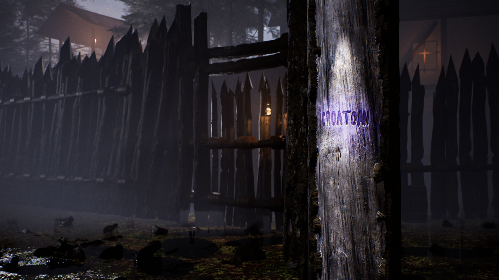

Side by side, painting left: [compare/2026-10-31_painting_vs_match_r2.jpg](compare/2026-10-31_painting_vs_match_r2.jpg) (round 1: [compare/2026-10-31_painting_vs_match_r1.jpg](compare/2026-10-31_painting_vs_match_r1.jpg)).

Answers the review of round 1: buildings not on the floor, a glowing patch between the house and the post, the carving not looking carved, the fog missing, and the lanterns missing. Same light balance; exposure back at +1.9 EV. Five test renders; this is the last. All in frame is still CC0 or our own; nothing bought, nothing downloaded this round.

**What changed:**
- **Real lanterns.** Poly Haven `Lantern_01` (CC0, already on disk) as the gate and tower lanterns: a dark iron frame, soft translucent glass, a small flame inside, and a tight haze around each light so it sits in the fog instead of hanging as a bright box. Two more far lanterns glimpsed between the stake tips, where the painting has them (frame 0.32, 0.22 and 0.93, 0.25).
- **Buildings on the ground.** The house now stands on a dark sill wall down to the mud. The watchtower has a log-walled lower storey down to the ground, with a warm glow in its gallery.
- **No glowing patch at top right.** Darker house walls, a weaker window light, and the far-right lantern kept dim.
- **CROATOAN carved.** Each stroke is now a V-groove about 1.8 cm deep in the same pale wood (earlier the cut used a near-black texture, so the letters read as flat purple paint). A faint raking light from above gives lit lips and shadowed insides. Wider letter spacing so "AN" no longer runs together. The T is still unmistakable.
- **Fog back.** Rolling ground mist low across the left and middle, thickest on the left; slightly more general fog.

| Band | Painting | Round 1 | Round 2 |
|---|---|---|---|
| 0-20% | 71.1% | 76.5% | 80.1% |
| 20-40% | 27.5% | 18.1% | 15.4% |
| 40-60% | 1.2% | 3.7% | 2.6% |
| 60-80% | 0.2% | 1.7% | 1.4% |
| 80-100% | 0.0% | 0.2% | 0.5% |
| Average | #272427 | #28252A | #262328 |

Edge agreement with the painting: round 1 49.4%, round 2 50.2%. Changed regions: tower lantern #84655D (painting #845D46), house window #5B3C32 (#5D4237), ground mist left #32323F (#39393D), gate gap #251D1E (#1B1918).

**Still different (honest):**
1. Nysa is still missing (needs Sydra's and the user's OK).
2. The gate lantern is small and mostly hidden behind a gate pole; its core reads dimmer than the painting's (#584030 against #BF8446 in the measured box).
3. The stripped face's upper part is brighter than the painting's (#5E595D against #393131), and the UV pool is paler lilac than the painting's violet.
4. The letters are still violet-filled where the UV beam hits the groove walls; the painting's are darker cuts in a violet pool.
5. The left wall is one long fence, not the painting's short bundle; the tower has no railed gallery; the house has no visible chimney; the mud has green moss specks.

## Painting match · round 3

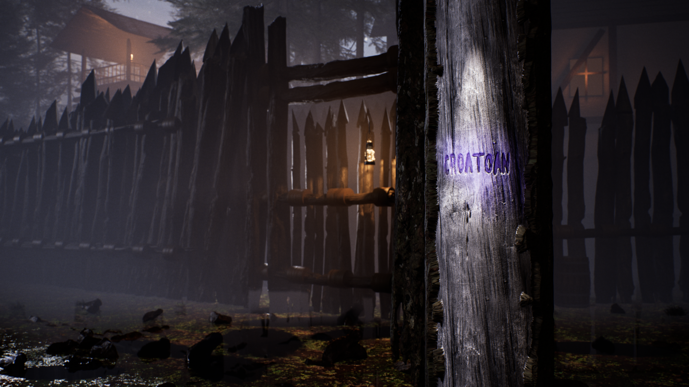

Side by side, painting left: [compare/2026-10-31_painting_vs_match_r3.jpg](compare/2026-10-31_painting_vs_match_r3.jpg).

Works through the differences left after round 2. Three test renders; this is the last. Nothing bought or downloaded.

**What changed:**
- **Gate lantern** about 40% bigger, more than twice as bright, and moved forward clear of the gate poles.
- **Left wall** stays tall by the gate and drops about 40% lower toward the left edge, so it no longer reads as one even fence.
- **Watchtower gallery** has balusters round the walk and a warmer glow inside.
- **Post face** fill light lowered and aimed lower; panel brightness 3.8 → 3.1.
- **Mud** stones and weeds re-tinted away from green.
- **House chimney** raised above the ridge (but it lands behind the post, out of frame; see below).

| Band | Painting | Round 2 | Round 3 |
|---|---|---|---|
| 0-20% | 71.1% | 80.1% | 74.9% |
| 20-40% | 27.5% | 15.4% | 20.1% |
| 40-60% | 1.2% | 2.6% | 3.2% |
| 60-80% | 0.2% | 1.4% | 1.5% |
| 80-100% | 0.0% | 0.5% | 0.4% |
| Average | #272427 | #262328 | #2B262A |

Edge agreement with the painting: round 2 50.2%, round 3 50.6%.

**Nysa: tried, left out.** I built a stand-in from the free female Mannequin that ships with Unreal (copied to `Content/Mannequin`): a long dark coat, hair, and a raised arm holding the UV lamp. In both tests she read as a toy robot with a bead wig, not a person, so this render leaves her out. The build script keeps her behind a switch (`LETHE_NO_NYSA=1` turns her off). A believable Nysa needs a real character: a MetaHuman (free for Unreal use, but it needs an Epic sign-in and a download), or a sculpted or commissioned figure.

**Still different:**
1. Nysa is missing (see above).
2. The upper post face is still brighter than the painting's (#5A5559 against #393131), and the UV pool is paler (#827892 against #564583).
3. The house chimney sits behind the post, out of frame. Getting the painting's chimney at top right needs the house roof moved, not just the chimney.
4. Yellow-green leaf specks in the mud texture (`brown_mud_leaves_01`) still show.
5. The far-left wall still runs to the frame edge, lower, rather than ending in the painting's short, leaning bundle.

## Painting match · round 4 · Nysa

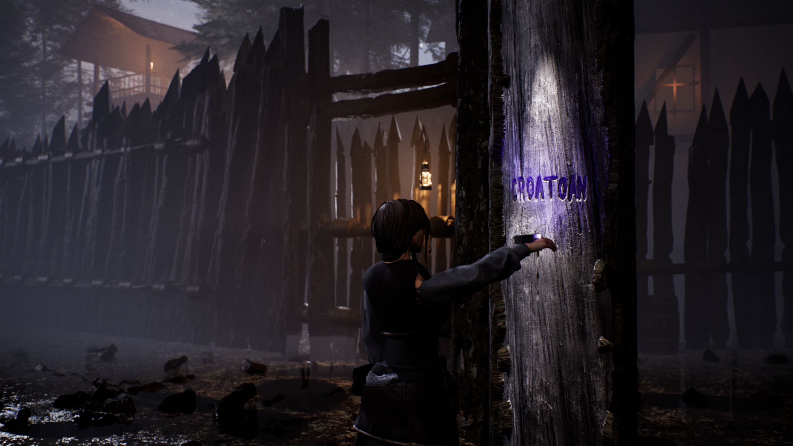

Side by side, painting left: [compare/2026-11-03_painting_vs_match_r4.jpg](compare/2026-11-03_painting_vs_match_r4.jpg).

**Nysa is in.** She is built from ["Free Medieval Assassin Girl"](https://www.fab.com/listings/2986b290-90ed-4a0e-a891-cacf442033f9) by Dimentrius3dArtist (Fab, free, CC BY 4.0), with the hood, mask and weapons removed. `tools/nysa_pose.py` (with `tools/mat4.py`, no numpy needed) poses her offline: her right arm is raised to shoulder height holding the UV lamp, and her left arm hangs down. It writes a static glTF that the build script imports. Her clothes and hair are darkened toward the painting. She stands with her back to the camera, left of the post.

**What else changed:**
- The UV beam now comes from her lamp. It is held at least 45 cm off the letters, so it never starts inside the bark, and it casts no shadow, so her own sleeve can't block it. The beam is wider to keep the pool the painting's size from that close.
- Post face panel 3.1 → 2.5 and fill 18 → 12; UV colour deeper violet.
- The mud texture is 70% desaturated and tinted warm, which removes the green leaf specks.

| Band | Painting | Round 3 | Round 4 |
|---|---|---|---|
| 0-20% | 71.1% | 74.9% | 78.1% |
| 20-40% | 27.5% | 20.1% | 18.2% |
| 40-60% | 1.2% | 3.2% | 2.5% |
| 60-80% | 0.2% | 1.5% | 1.0% |
| 80-100% | 0.0% | 0.4% | 0.1% |
| Average | #272427 | #2B262A | #262227 |

Edge agreement with the painting: round 3 50.6%, round 4 50.0% (Nysa's outline sits a little right of the painting's).

**Still different:**
1. Nysa's hair is short and tied back; the painting has long dark curls down her back. She also has no shoulder bag, and her skirt is shorter than the painting's long coat.
2. She sits a little low and right in the frame (head at 0.51, 0.53 against about 0.57, 0.45 in the painting).
3. The beam's visible shaft in the air is missing: the painting shows a bright violet cone between lamp and post.
4. The house chimney is still out of frame, and the far-left wall still runs to the frame edge.

## Painting match · round 5 · Nysa's hair and the beam

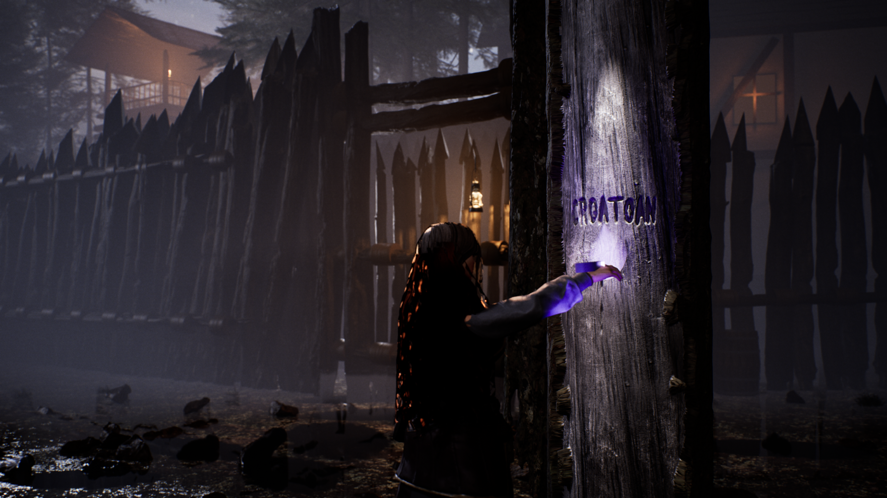

Side by side, painting left: [compare/2026-11-03_painting_vs_match_r5.jpg](compare/2026-11-03_painting_vs_match_r5.jpg).

Six test renders; this is the last. Nothing bought or downloaded.

**What changed:**
- **Long curly hair.** `tools/make_curl_texture.ps1` draws a ringlet texture with alpha: clumps of strands that share one curl, with ragged ends. `tools/nysa_pose.py` adds three curved hair layers to her model. They start low on the back of her head, so her face and the side of her head still show, and hang to mid-back. The layers are cut out by the texture's alpha. (Stretched spheres were tried first and read as black balloons.)
- **Warm rim light** on her from behind-left (the gate lantern's side). It picks out the curls and her shoulder as the painting does.
- **UV beam.** The light sits 90 cm back from the letters, on the line through her lamp, which gives a large soft pool. A faint additive cone runs from the lens toward the post and fades to nothing at the bark. The lens glows brighter.

| Band | Painting | Round 4 | Round 5 |
|---|---|---|---|
| 0-20% | 71.1% | 78.1% | 77.7% |
| 20-40% | 27.5% | 18.2% | 18.5% |
| 40-60% | 1.2% | 2.5% | 2.6% |
| 60-80% | 0.2% | 1.0% | 1.0% |
| 80-100% | 0.0% | 0.1% | 0.2% |
| Average | #272427 | #262227 | #272227 |

Edge agreement with the painting: round 4 50.0%, round 5 49.4% (the hair adds edges where the painting has none).

**Still different:**
1. The beam is a soft glow on the post rather than the painting's distinct violet shaft from the lamp: her lamp sits too close to the bark for a long shaft. Her raised sleeve also picks up violet light.
2. The curls are a little too regular and too long; the painting's hair is fuller around the head.
3. She has no shoulder bag, and her skirt is shorter than the painting's long coat.
4. She sits a little low and right in the frame. The house chimney is still out of frame, and the far-left wall still runs to the frame edge.

## Painting match · round 6 · a realistic Nysa, the painting's camera

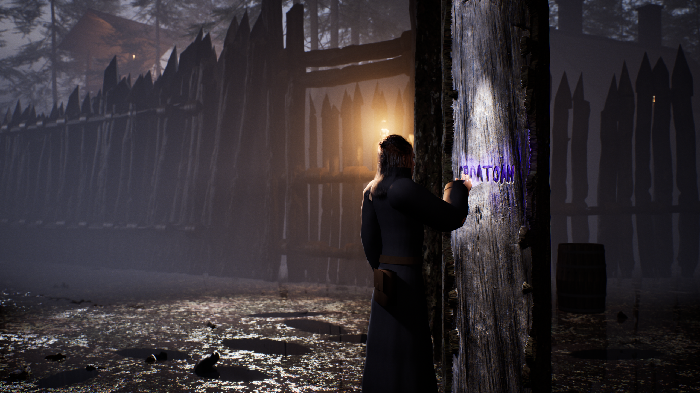

Side by side, painting left: [compare/2026-11-04_painting_vs_match_r6.jpg](compare/2026-11-04_painting_vs_match_r6.jpg).

**Nysa is now a MetaHuman.** The stand-in from rounds 4 and 5 is no longer in the scene (its credit stays above, since those two renders still show it). MetaHuman Creator Core Data (free, from the Epic Games Launcher) is installed, and the character is built entirely by script:
- `tools/make_nysa_mh.py` creates her: skin, dark eyes, 1.70 m, long hair, brows, lashes. Epic's MetaHuman service rigs the face and sends the skin textures (needs the editor's Epic login), then builds `BP_MH_Nysa`.
- `tools/make_nysa_mh_hair.py` sets the hair and brows to near-black brown (Melanin 0.92), then rebuilds.
- `tools/make_nysa_pose_anim.py` solves her arms and writes a one-frame pose: right arm raised with the lamp to the letters, left arm hanging.
- `tools/make_nysa_coat.py` builds her long dark coat around that pose: sleeves, belt, shoulder bag and strap. MetaHuman ships no coat.

**The camera now matches the painting's.** Measured against the painting, the old camera was too high and too close: Nysa filled the frame and was cut off at the thighs. It is now 1.3 m high and 78 cm further back, and the post sits 35 cm lower, so CROATOAN is at her chin. Nysa is 3/5 of the frame tall, head to feet, as painted.

**Also changed:**
- Fog density doubled.
- The house behind is rebuilt at the painting's size and place: a gabled house well behind the palisade, roof and two chimneys against the fog, warm windows in its gable.
- Fewer, smaller, mud-coloured stones in the foreground, and smaller puddles.
- The UV light now comes from the lamp's lens, not from inside her arm.

`tools/close_bp_error_dialog.ps1` answers Unreal's "Blueprint Asset Compilation Error" prompt with *Play in Editor*. The MetaHuman's Live Link face blueprint fails to compile after every rebuild, and that prompt otherwise stops the render.

**Still different:**
1. Her hair is long but straight and wavy, not the painting's ringlets, and the warm rim light makes it read auburn.
2. The stripped panel on the post is grey; the painting's is pale cream with many names carved above CROATOAN.
3. The puddles read as dark holes; the painting's mud is churned, with the lantern's light in the wet.
4. The gate lantern sits behind her head; in the painting it is just left of it, smaller.

## Painting match · round 7 · Nysa's curls

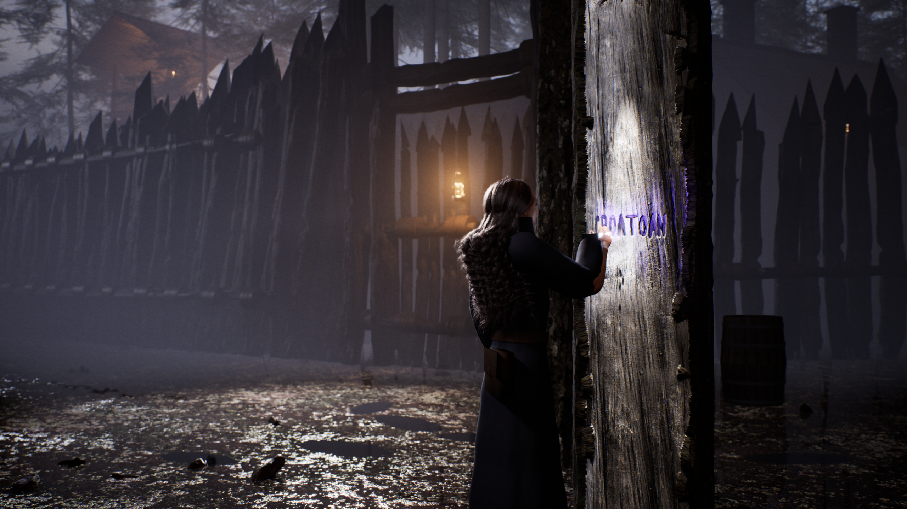

Side by side, painting left: [compare/2026-11-05_painting_vs_match_r7.jpg](compare/2026-11-05_painting_vs_match_r7.jpg).

**What changed:**
- **Long dark ringlets.** MetaHuman has no long curly style, so `tools/make_nysa_curls.py` generates one: 14,000 strands in 254 clumps, written as a USD groom (curves with Unreal's GroomAPI). The USD importer plugin is now on. Roots cover the top, sides and back of her head. The hair flows over the skull, then hangs down her back over the coat in loose ringlets of varied size and length, standing off the back by different amounts so it has depth. It renders with a dark brown strand material, with simulation off so it doesn't sag during the render.
- **Gate lantern** moved left of her head as painted, with a smaller glow.
- **Post panel:** paler and warmer (cream rather than grey), lit more strongly.
- **Lamp:** a small violet glow at its lens, so you see where the beam comes from.
- **Rim light** on her: weaker and cooler, so the hair reads dark brown, not auburn.
- **Puddles:** dull sky reflection instead of black holes; the two nearest are removed.
- **Sleeve cuffs** slimmer.

**Still different:**
1. The panel shows CROATOAN only; the painting has many other names carved above and below it.
2. The mud is flat; the painting's is churned and rutted.
3. Her coat is plain wool, with none of the painting's folds or seams in the light.

## Painting match · round 8 · the names, the mud, the coat

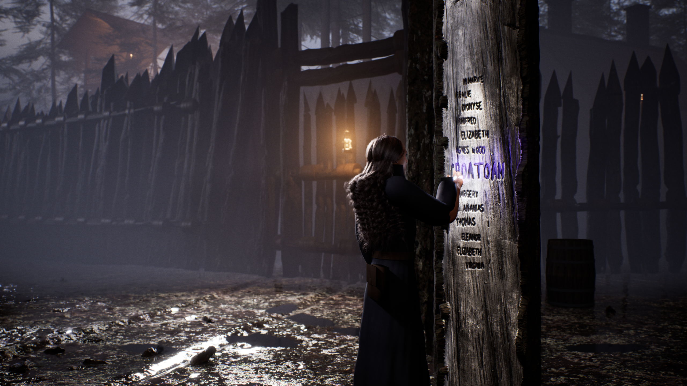

Side by side, painting left: [compare/2026-11-05_painting_vs_match_r8.jpg](compare/2026-11-05_painting_vs_match_r8.jpg).

**What changed:**
- **The other names.** `tools/make_panel_mask.ps1` has a scratched alphabet now. It cuts twelve names of the 1587 colonists into the panel, six above CROATOAN and six below: Agnes Wood, Elizabeth, Winifred, Dionyse, R. Bailie, M. Harvie, Margery, Ananias, Thomas, Eleanor, Elizabeth, Virginia. They are smaller and shallower than CROATOAN, each line tilted a little, each letter cut on its own. The post mesh is finer over the whole carved band, so the cuts are real geometry. The script's default axis order is fixed to the one the post has always used (x, -y, z).
- **Sculpted mud.** `tools/make_mud_patch.py` builds the foreground as a heightfield mesh, 5 cm grid over 15 x 20 m. It has two shallow cart ruts running into the gate on the left, about 300 old footprints trodden in, clods, and Nysa's own fresh prints leading up to where she stands. The flat ground sits 6 cm lower and only shows beyond it.
- **Coat folds.** Deeper, sharper folds in the skirt that catch the light, a centre-back seam with a vent below the hips, and twice the resolution around.

**Still different:**
1. The painting's mud has more broken, glossy highlights from the lantern; ours is lit mostly by the cool fill.
2. The far left: the painting's wall foot is lost in thick low mist; ours is clearer.
3. The tower top left is less visible than in the painting.

## Painting match · round 9 · mist, tower, mud light

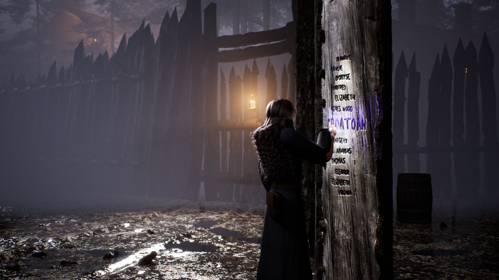

Side by side, painting left: [compare/2026-11-05_painting_vs_match_r9.jpg](compare/2026-11-05_painting_vs_match_r9.jpg).

**What changed:**
- **Mist at the far left.** Three more low fog volumes lie on the foot of the left wall, so it fades into a pale bank as painted.
- **Watchtower.** Its lamp and the warm light in its gallery are brighter, so the tower reads as a glow in the fog top left.
- **Warm light on the mud.** A low, shadowed warm spot from the gate side, off to Nysa's left, puts a little of the lantern's colour in the wet mud. A first try sat right behind her: it turned her hair ginger and burnt a hotspot into the mud, so it was moved and dimmed.

**Still different:**
1. The tower itself, its legs, gallery and roof, is mostly lost in the fog; the painting shows its shape clearly.
2. The warm glints on the mud are fainter than the painting's.

## Painting match · round 10 · the watchtower

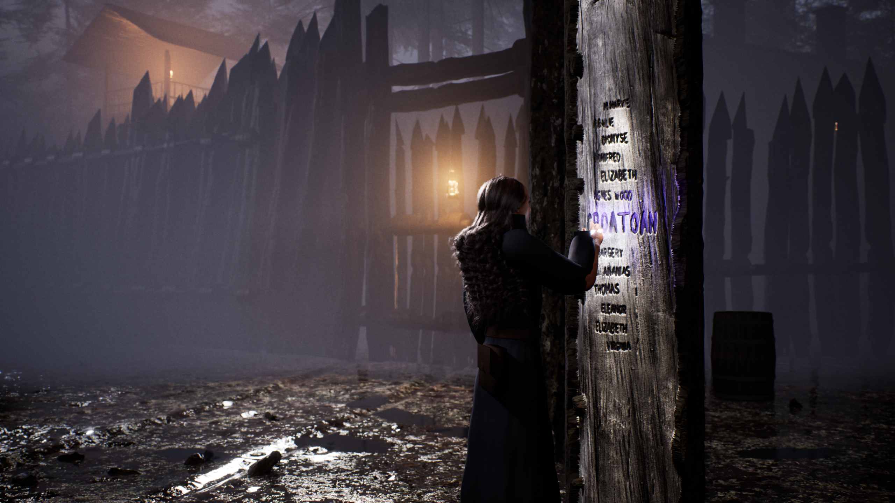

Side by side, painting left: [compare/2026-11-05_painting_vs_match_r10.jpg](compare/2026-11-05_painting_vs_match_r10.jpg).

**What changed:**
- **The tower stands nearer.** It was 32 m away, at the painting's frame position, so the fog swallowed it. It is now built at 0.62 scale about its foot and stands about 18 m away in the same frame position. Its roof, railed gallery, lamp and log walls read through the fog, as painted. Its lights are dimmed to match the nearer distance (a first try at the old strength became an orange haze).
- **Mud light:** the cool glint is halved and the warm one doubled, so the wet mud is darker and warmer.

**Still different:**
1. The painting's left wall comes nearer the camera, with a heavy log along its foot; ours recedes.
2. The painting's stake tips are rounded and pencil-sharpened; ours are faceted.

## Painting match · round 11 · pencil-sharpened stakes

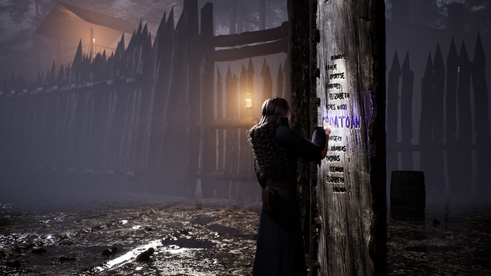

Side by side, painting left: [compare/2026-11-05_painting_vs_match_r11.jpg](compare/2026-11-05_painting_vs_match_r11.jpg).

**What changed:**
- **Stake tips.** `tools/make_hewn_tips.py` now whittles each point all round with 9 to 14 narrow cuts, instead of 3 or 4 axe strokes. The result is a long, round-looking point, nearly centred, like the painting's pencil-sharpened logs. The build re-imports the tips every time.
- **Left wall.** A heavy 36 cm rail log runs along its foot, at 58 cm, with a second rail higher up. More moonlight falls on it, so the bark reads blue-grey.

The painting's left wall is no closer to the camera than ours: measured, both meet the left frame edge with their foot about 13 m away. The difference was in the stakes and the light.

**Still different:**
1. The rail at the left wall's foot is lost in the mist; the painting shows it as a dark line.
2. Small things: the painting's coat has a visible strap across the back, and her hair has more defined ringlets near the crown.

## Painting match · round 12 · Nysa's crown, bag and sleeve

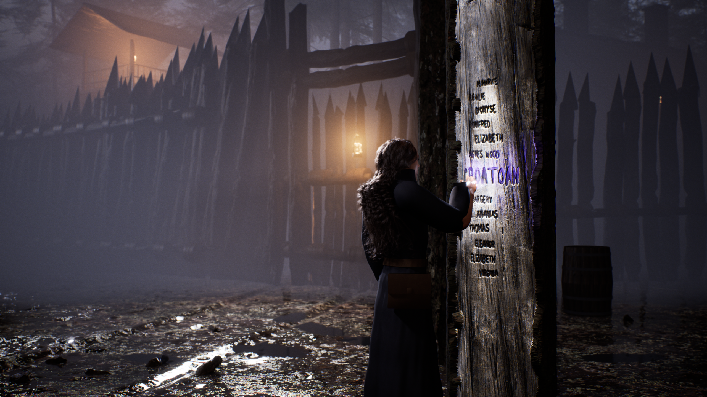

Side by side, painting left: [compare/2026-11-05_painting_vs_match_r12.jpg](compare/2026-11-05_painting_vs_match_r12.jpg).

**What changed:**
- **Curly from the crown.** The curls now start as loose waves right at the top of her head and stand fuller off the skull, instead of lying flat until the ears. The hanging mass falls a little toward her left, as painted.
- **The bag** hangs round on her right flank, a little behind, so in this shot it sits centre-right of her back below the belt, on the post side, as in the painting. Its strap runs cross-body from her left shoulder. Checked from straight behind her first: the shot sees her from behind her left, so her right hip had shown on the far side, under her hair.
- **Left sleeve** looser and nudged out, running to the wrist; the hanging forearm had shown skin along it.
- Leather a little lighter.

**Still different:**
1. The strap across her back is hard to see in this light.
2. The rail at the left wall's foot is lost in the mist.

## Painting match · round 13 · tone, the right wall, the house

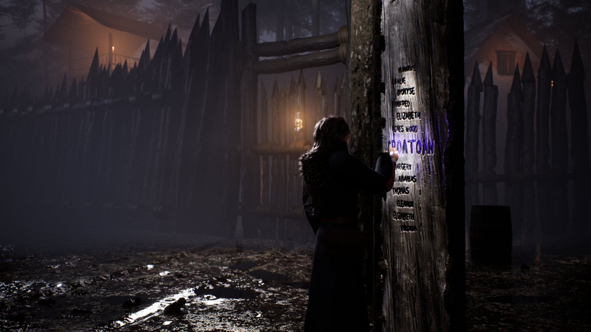

Side by side, painting left: [compare/2026-11-05_painting_vs_match_r13.jpg](compare/2026-11-05_painting_vs_match_r13.jpg).

**Measured first.** Average colour in a 3 x 3 grid showed round 12 was 1.5 to 2.5 times brighter than the painting almost everywhere, worst round the gate and on the left: the doubled fog was glowing.

**What changed:**
- **Darker, as painted.** Exposure bias 1.9 → 1.1 (`LETHE_BEAUTY_EV`; higher is brighter). Fog 0.040 → 0.032, its glow halved, gate lantern 16 → 11 lm, sky a little brighter. Seven of the nine grid cells are now within about 10 levels of the painting.

| Cell | Painting | Round 12 | Round 13 |
|---|---|---|---|
| top left | 65 62 68 | 93 81 88 | 56 46 51 |
| left | 40 39 42 | 72 70 85 | 39 37 48 |
| centre | 27 23 25 | 70 58 57 | 37 30 31 |
| post | 36 31 40 | 52 49 57 | 31 28 34 |
| bottom left | 41 40 42 | 67 63 68 | 40 38 41 |

- **The right-hand wall** gets cool moonlight, so its stakes read grey-blue with bark, not as black silhouettes.
- **The house** is turned with its gable end toward us and placed so its high gable window shows above the stakes, top right, as painted. It has warm windows and a cool moon fill on its wall and roof.

**Still different:**
1. The top right is still darker than the painting's lit fog.
2. The centre, through the gate, is a little brighter than the painting's.

## Painting match · round 14 · the fog behind the house

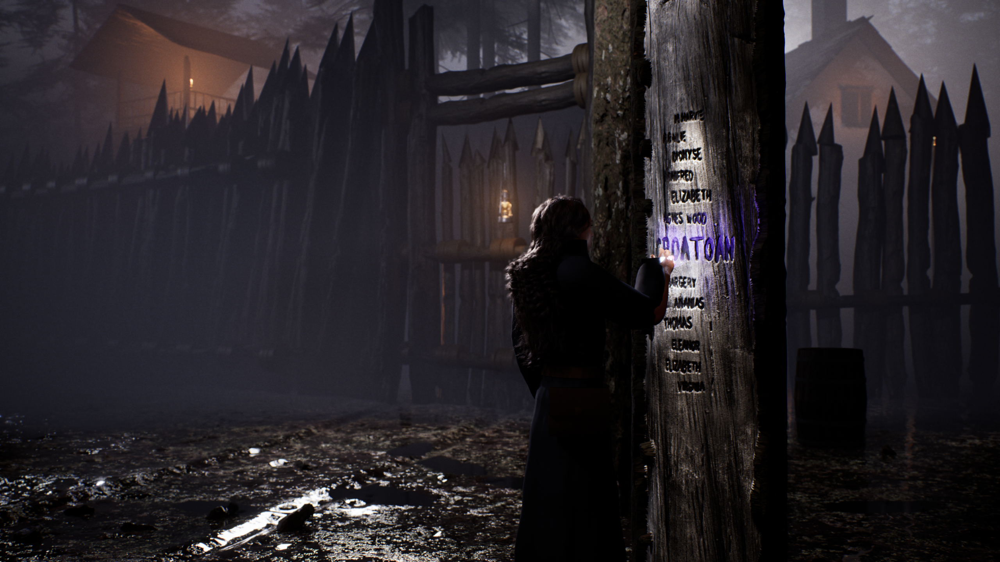

Side by side, painting left: [compare/2026-11-06_painting_vs_match_r14.jpg](compare/2026-11-06_painting_vs_match_r14.jpg).

**What changed:**
- **Lit fog behind the house.** A broad, cool light 16 m behind the house makes the fog there glow, so the house, its chimney and the right-hand stakes stand dark against it, as painted. 6000 lm overshot (top-right cell 74 against 53); it is 3600 lm.
- **Darker gate gap.** The gate lantern is down to 8 lm and lights much less of the fog around it.

| Cell | Painting | Round 13 | Round 14 |
|---|---|---|---|
| top left | 65 62 68 | 56 46 51 | 57 48 53 |
| top centre | 45 45 49 | 34 29 33 | 44 40 45 |
| top right | 53 47 48 | 26 23 27 | 61 56 60 |
| left | 40 39 42 | 39 37 48 | 38 38 48 |
| centre | 27 23 25 | 37 30 31 | 32 28 31 |
| post | 36 31 40 | 31 28 34 | 36 33 40 |
| bottom left | 41 40 42 | 40 38 41 | 40 37 41 |
| bottom centre | 22 19 17 | 32 28 29 | 32 29 30 |
| bottom right | 24 20 16 | 12 10 10 | 14 12 11 |

**Still different:**
1. The bottom centre (her coat and the mud at her feet) is a little brighter than the painting's; the bottom right, at the post's foot, is darker.

## Painting match · round 15 · Nysa, close up

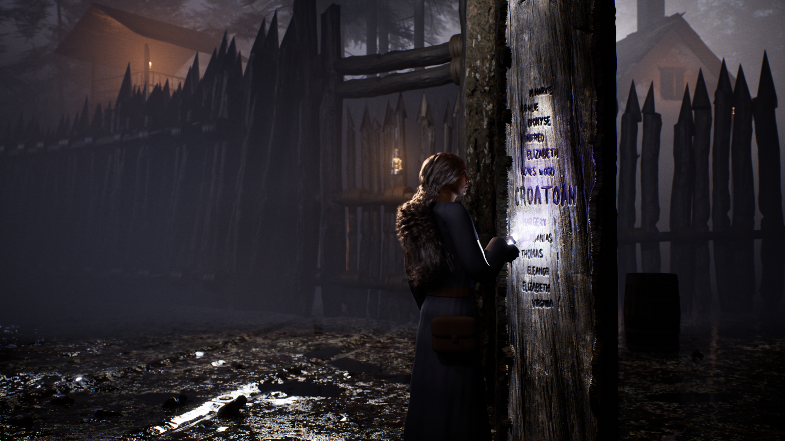

Side by side, painting left: [compare/2026-11-06_painting_vs_match_r15.jpg](compare/2026-11-06_painting_vs_match_r15.jpg). Nysa close up against the painting: [compare/2026-11-06_nysa_close_r15.jpg](compare/2026-11-06_nysa_close_r15.jpg).

**What changed:**
- **Her pose.** She was reaching out with a straight arm. Now her elbow is down by her side and her hand holds the torch at chest height, as painted. `tools/make_nysa_pose_anim.py` closes her right hand round the torch: each finger curls joint by joint toward the palm and the thumb wraps. The wrist turns so the torch points at the letters, and the torch's place in her fist is written out for the scene build. Her head turns 28 degrees toward the post, so her face shows in profile.
- **The torch:** a dark metal body with a wider head, a violet lens and a bigger glow, set in her fist and aimed by the pose; the UV light and beam come from its lens.
- **Gloves.** Only her hands show under the coat, so the MetaHuman body is dark leather: gloved hands, as painted.
- **Hair.** 26,000 finer strands in 288 ringlets that sway and loosen toward the ends. Each strand gets a slight crimp, one in twenty works loose, and each takes its own shade of dark brown from the groom's per-strand seed. The scalp part turns with her head, and the roots now cover the whole crown down to the brow. (A first try spread the strands loosely and read as a fuzzy pelt.)
- **Coat:** fitted sleeves (they were thick tubes), the collar at the base of her neck, not a turtleneck.
- **Satchel:** a soft, rounded, sagging leather bag with a flap, in dark brown, instead of a box.
- **Light on her:** a soft moon fill on her back and a warm edge from the gate side on her hair. Both are on their own lighting channel, so they light only her (the fill had first burnt the post white).

**Still different:**
1. The top of her hair catches a cool grey sheen; the painting's highlights are warm brown.
2. The ringlets still hang as one mass; the painting's fall in separate locks with gaps between.
3. The painting shows the strap across her back and a belt buckle; ours are hidden or plain.

## Painting match · round 16 · real hair, her face, her hand

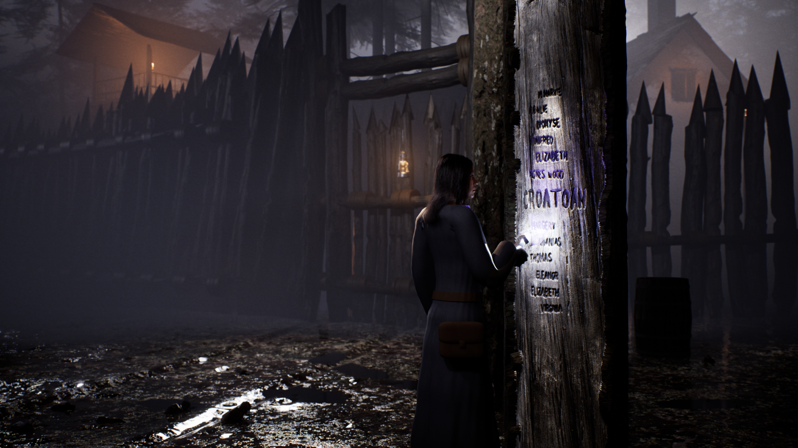

Nysa close up against the painting: [compare/2026-11-07_nysa_close_r16.jpg](compare/2026-11-07_nysa_close_r16.jpg).

**What changed:**
- **Real hair first** (the user's choice over tight curls). No free long curly hairstyle on Fab fits the project rules: the curly ones are paid, or marked "Allows usage with AI: No". So the generated curls are off (`LETHE_NYSA_CURLS=0`), and she wears MetaHuman's own **Long Straight** hairstyle in dark brown. `tools/make_nysa_mh_hair.py` can now swap the hairstyle (`LETHE_MH_HAIR_ITEM`) and finds the hair's colour controls itself. The style is bound to her head, so it turns with her face. On her it is shoulder length: a check render without the coat showed nothing hidden under it. ("Messy Clumps" was tried first and is shorter still.)
- **Her face:** a violet bounce light from the lit post falls on her profile, as painted, on her lighting channel only.
- **Her hand:** the gloves have a soft leather sheen so the fingers read, and the torch reaches 4 cm further out of her fist.

**Still different:**
1. Her hair is shoulder length and straight; the painting's falls in curls to mid-back.
