# CROATOAN gate beauty corner: build log

Target: `art/levels/roanoke/croatoan-gate.jpg`. Unreal Engine 5.8.4, Lumen (software; this Shadow PC's NVIDIA 565.90 driver crashes with hardware ray tracing), volumetric fog.
Assets: free Quixel Megascans from Fab (Standard License, $0 for Unreal): Old Wooden Log x2, Old Wooden Beam, Soil Mud, Wild Grass, Military Trenches Ground Mud. The CROATOAN carving and the scratched 1587 colonists' names are our own texture.
Project: `C:\LETHE` (map `L_Beauty_CroatoanGate`, script `Scripts/build_beauty_gate.py`).

## Round 1 · 2026-10-29

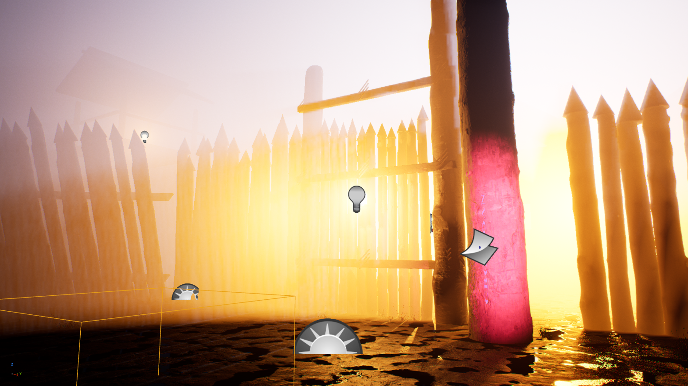

Working: real scanned bark and cracks on every log; wet mud with puddles in the low spots; composition close to the reference (bastion left, lashed pole gate with lantern, dark gatepost, stripped post right).

Differences from the reference, to fix in round 2:
1. Fog glows yellow-white; the reference is a dark blue-grey night. Warm light behind the wall floods the fog, and the fog scatters strongly toward the camera.
2. CROATOAN reads vertically: the carving decal is rotated 90°.
3. Post reads magenta (violet UV beam mixed with orange light); should be pale wood under a cool violet beam.
4. Editor icons (light bulbs, fog sprite, a volume outline) were captured in the render.
5. Still the old 24 mm camera; the 35 mm low-angle camera from the brief applies from round 2.
6. No rocks or weeds yet; tall grass reads too sparse.

## Round 2 · 2026-10-29

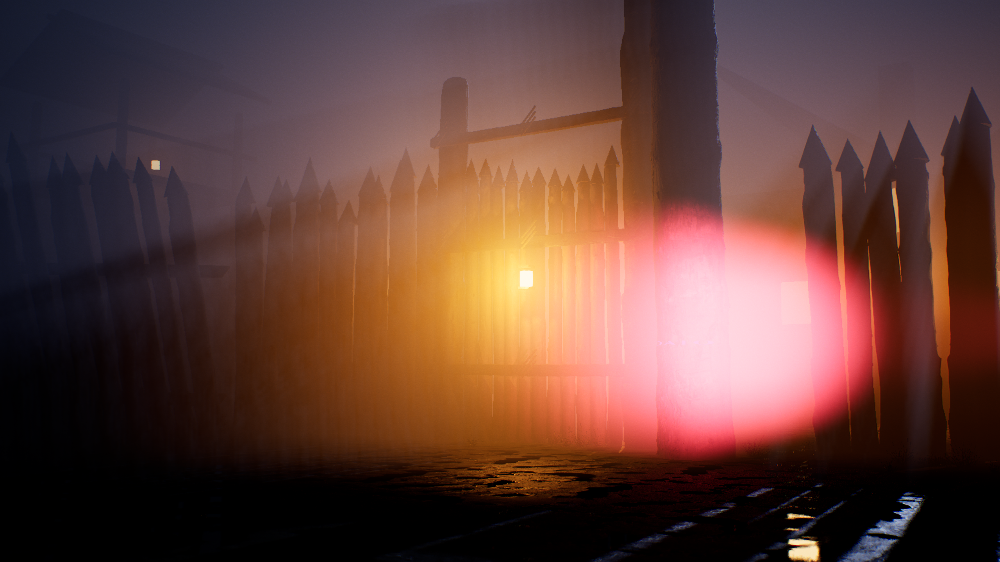

Fixed since round 1: night mood (dark blue-grey fog, less forward glare), 35 mm low-angle CineCamera with shallow depth of field, lanterns limited to ~8 m, carving decal rotated to read horizontally, editor icons removed, every exposure saves.

Differences from the reference, to fix in round 3:
1. A large pink blur hides the CROATOAN post and its carving: the UV lantern's light source now sits inside the 35 mm frame. Move it out of frame to the right and soften its glow in the fog.
2. The stripped post must read as the brightest, palest object; it is currently hidden.
3. Fog leans mauve; the reference is colder blue-grey.
4. Ground foreground is good (wet mud, reflections); grass and weeds barely read.
5. Warm glow behind the gate is still larger than the reference's small lantern points.

## Round 3 · 2026-10-29

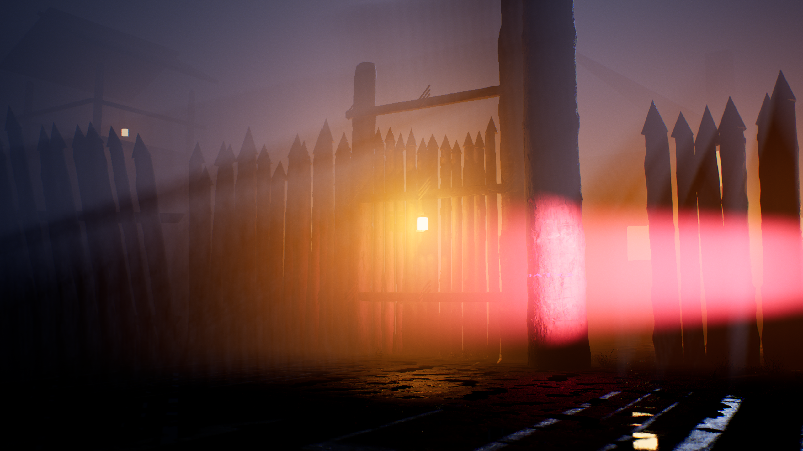

Fixed since round 2: the UV lantern is out of frame; colder fog; dimmer gate lantern.

Differences from the reference, to fix in round 4:
1. The UV beam reads as a wide, out-of-focus pink band across the frame; the reference has a tight violet-blue beam landing on the letters.
2. The carving decal's width and height were swapped by the rotation, so CROATOAN is stretched about 2.5 m round the post and only a sliver shows.
3. The stripped post doesn't read pale: nothing lights it from the front. The reference post is the palest, best-lit object.
4. Grass, weeds and rocks still barely read.

## Round 4 · 2026-10-29

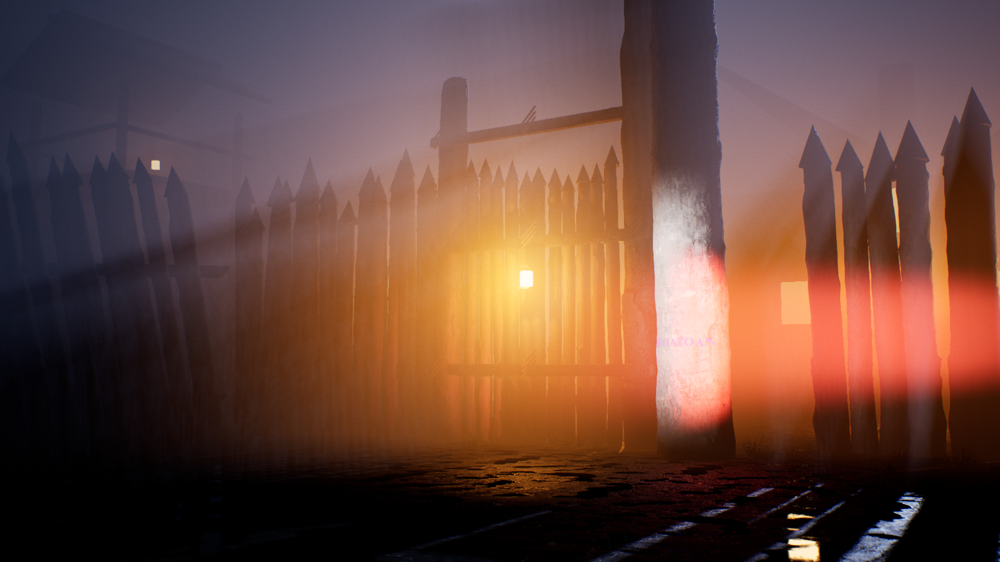

Fixed since round 3: the stripped post now reads as the palest object (cool fill from out of frame); CROATOAN is legible at 1.5 m; deeper focus.

Differences from the reference, to fix in round 5:
1. The UV beam renders red-orange instead of violet: the light colour channels were set in the wrong order.
2. CROATOAN is too small in frame: the camera is ~13 m from the post, where the reference stands close. Move to ~8 m, keeping the bastion and gate in shot.
3. Rocks, weeds and tall grass still to add.

## Round 5 · 2026-10-29

No image: the editor throttled itself to ~3 fps while it was not the front window and every capture timed out. Fixed in `Config/DefaultEditorPerProjectUserSettings.ini` (`bThrottleCPUWhenNotForeground=False`). Its changes (violet beam colour, closer camera) went into round 6.

## Round 6 · 2026-10-29

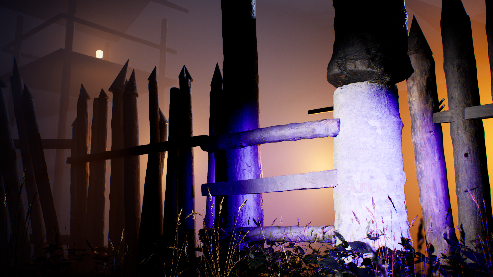

New since round 4 (design-session review applied): irregular axe-hewn wedge tips, some broken flat; trunks 25-45 cm x 3.5-4.5 m with random lean and spin, a few gaps; lashed cross-rails; the entrance rebuilt as a narrow gap between two great posts barred with heavy timbers (the CROATOAN post is now the right-hand post itself), bark left on above the stripped band; carved-normal on the letters; 8 more free Megascans (3 rocks, curbside weeds, nettle, dry grass, wheat grass, dead shrubs) crowding the wall foot; watch platform with its lantern in the fog, top left as in the reference.

Differences from the reference, to fix in round 7:
1. Camera too close and too low: the post fills the frame and is cropped; the flanker and gate are mostly out of shot. Go to 40 mm at ~8.6 m, eye height.
2. Violet floods the rails and the left gatepost; the UV beam should be a tight spot on the letters only.
3. CROATOAN barely reads: the violet glow washes out the dark cuts. Darker, deeper grooves; less UV emission.
4. The bark band above the stripped section bulges like a cap; it should be flush.
5. A floating lantern hook rod; the warm glow behind the right wall is too strong.

## Round 7 · 2026-10-29

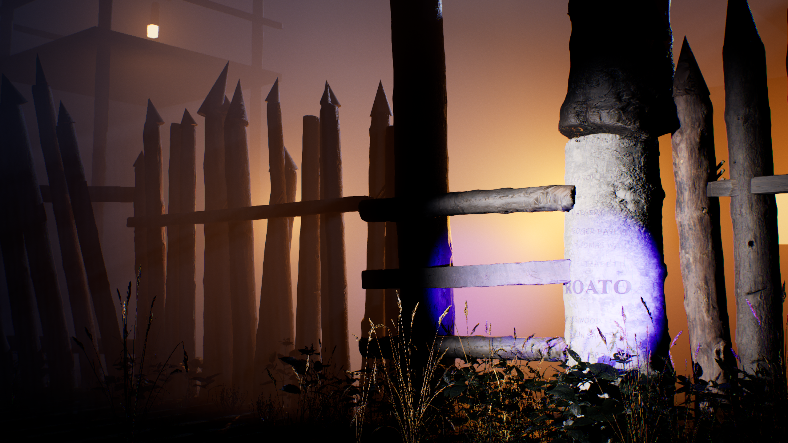

Fixed since round 6: 40 mm framing with the watch platform, flanker, barred gap and post all in shot; the UV beam is a tight spot; the later names (MARGERY HARVIE, ROGER BAYLYE, THOMAS WARNER…) read on the post.

Differences from the reference, to fix in round 8 (with the design session's round 6 review):
1. CROATOAN shows only "ROATO": it wraps past the visible face, and a gate bar crosses the 1.5 m line. Turn the carving to face the camera, use condensed Roman capitals (~11 cm) on a wider post, move the bars clear.
2. The cuts read lavender, not dark: remove the UV glow from the grooves.
3. The stripped band reads as white plaster; it should be cream-to-tan wood with grain.
4. Palisade: thicker trunks (35-55 cm) set tight with no daylight; rails behind the trunks, not in front.
5. Orange haze behind the wall; the reference is a cool blue-grey night with small warm points.

## Round 8 · 2026-10-29

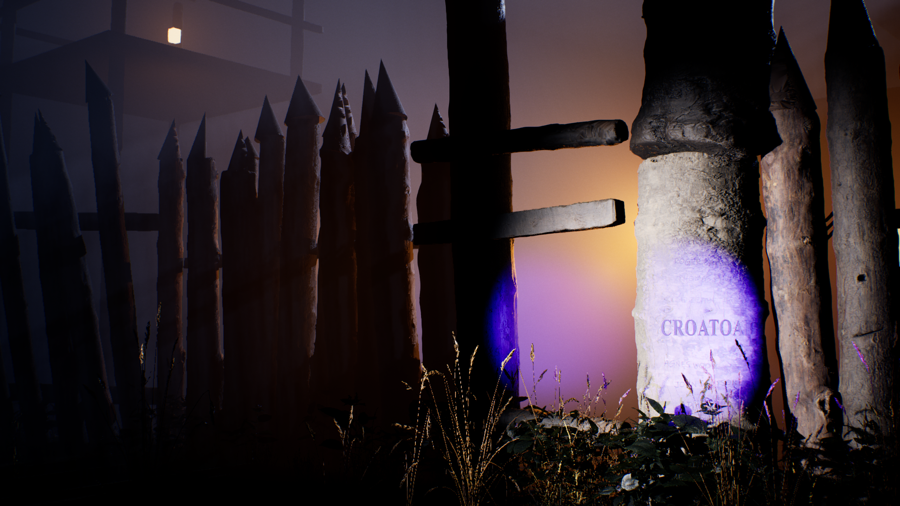

Fixed since round 7: CROATOAN reads in dark, deep Roman capitals at 1.5 m with the later names round it; the carving faces the camera on a wider post; stripped band is pale tan wood with grain; trunks 35-55 cm set tight with rails behind; the orange is mostly gone.

Differences from the reference, to fix in round 9:
1. The final N is clipped at the post's edge: narrow the word slightly and centre it on the visible face.
2. The UV spot also lights the left gatepost through the gap: tighter cone.
3. Gate bars stop short of the post.
4. The bark band above the stripped section still bulges like a cap (the scan used has a knot there).
5. Warm glow behind the gap still a little large.

## Round 9 · 2026-10-29

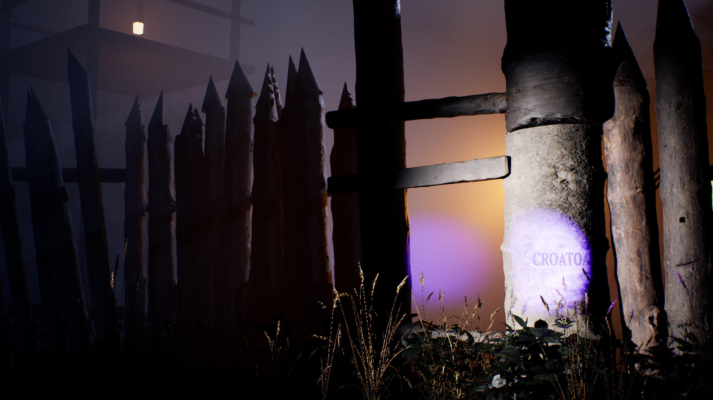

Fixed since round 8: flush bark band above the stripped section; gate bars reach the post; tight UV spot; smaller warm glow behind the gap.

Differences from the reference, to fix in round 10 (final pass for now):
1. The last N is still clipped: turning the carving to -31° moved it the wrong way. Turn to about -12°.
2. The letters look printed (design-session review): cut them by hand: each letter its own size, tilt and baseline, uneven spacing, V-grooves with chipped edges, wood grain visible inside the cuts.

## Round 10 · 2026-10-29

New: CROATOAN cut by hand: each letter its own size, tilt and baseline, uneven spacing, V-grooves with chipped edges, wood grain inside the cuts (`tools/make_carving_mask.ps1`). The scene script is in `tools/build_beauty_gate.py`.

Still to fix (round 11): the final N touches the post's edge; the cuts read lighter than in round 9.

## Round 11 · 2026-10-29

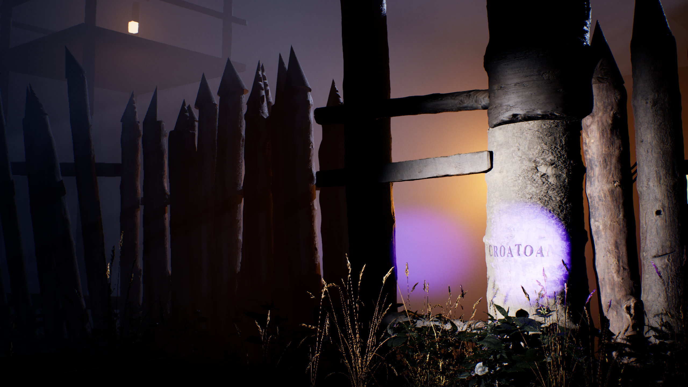

Darker cuts with grain; turning the carving moved the word left, but it was simply wider than the visible face: C at the left edge, N still clipped.

## Round 12 · 2026-10-29 · first beauty pass done

All eight letters of CROATOAN read: hand-cut Roman capitals, 1.5 m up the stripped right-hand post, in the violet beam, with the later names scratched round them. Word narrowed 20% to sit on the visible face.

Agreed with the design session: this closes the first beauty pass. A second pass will come with Nysa (MetaHuman) in the shot. Known items for that pass: the warm glow behind the gap is still a little large; the left gatepost catches some violet; Nysa and her lantern replace the off-screen UV source.

## Sketch match · round 1 · 2026-10-30

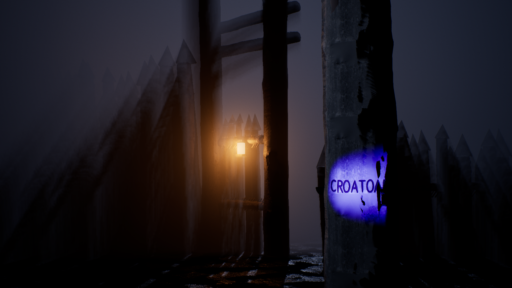

Scene rebuilt against `art/levels/roanoke/croatoan-gate.jpg`. Render 2560x1440, 35 mm at eye height 1.6 m, exposure -2 EV.

New this round:
- Moonlit blue-grey fog. Warm light only from the gate lantern, the tower lantern and the house windows. UV beam aimed at the post only.
- Wet mud ground with puddles, a few stones, small tufts at stake feet only (no tall grass).
- Thicker CROATOAN post (76 cm) with a tall stripped panel. Letters are 10 cm high at 1.5 m. No cross, no extra names.
- Gate between two posts with lashed crossbars, rope-lashed rails on the palisade, stakes of uneven height, lean and girth.
- Axe-cut stake points built from our own faceted meshes (`tools/make_hewn_tips.py`), not cones.
- Watchtower with shingle roof, rails and lantern. Timber-frame house with chimney and two lit windows.

Still far from the sketch (round 2):
1. Composition: the two gateposts stand like a tall ladder in mid-frame. The palisade on the left fills too much of the frame. The tower and house are lost in the fog.
2. Fog is too thick and shows streaky shadow shafts. It needs to be thinner near the camera so the background shapes read.
3. The UV pool is a hard, saturated blue oval. It should be a softer violet wash.
4. The stripped panel reads grey, not pale wood. The last N is clipped at the post edge, and the letters still look too even.
5. Stake points are too regular and slightly wider than the log, so they read as arrowheads.
6. The foreground mud is too flat and empty.

## Sketch match · round 2 · 2026-10-30

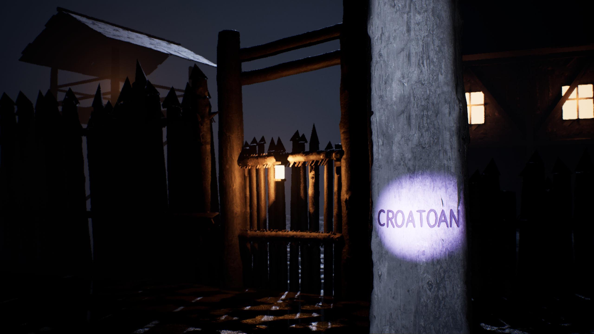

Changes from the round 1 review (exposure -0.5 EV):
- A. Camera 4 m from the post, looking along one wall that recedes left. The gate opening with its lantern is centre-left. The right gatepost stands close to the CROATOAN post, and a short run of palisade continues behind it to the right. The lintels now span only the opening.
- B. Every letter is cut differently: height ±15%, tilt ±4°, wandering baseline, its own stroke weight, uneven spacing. All 8 letters sit on the panel with margin. A few dry cracks run with the grain.
- C. UV beam is violet-white with a soft edge, held off-axis from the left, about 1.5x the width of the word.
- D. The post uses its own log scan (the old mismatch gave the "grey paint" look). The panel grain now comes from one continuous strip of the scan, with no repeated tiles. A torn bark rim with depth runs round the panel edge.
- E/F. Fog shadow shafts are off. The sky and fog glow are lifted, so the watchtower (top left) and the house with two lit windows (top right) read as dark shapes.
- G. Thicker rope lashings on the gate crossbars beside the lantern.
- Stake points no wider than the log, shorter and more uneven.

Still to fix (round 3):
1. The fog went too thin. The background is too crisp, and the tower and house look too near. Bring back a light, even haze that grows with distance, and push the tower and house further back or make them smaller.
2. The tower roof reads as one flat slab. It needs visible shingle rows and a darker underside.
3. The post bark edges are not dark enough against the pale panel. Darken the bark and make the rim stand out more.
4. The mud foreground shows a regular tile pattern in the puddles. Break it up with the mud decals and more stones.
5. At this distance the letters still look a little even. The variation could go further.
6. The house windows are a little too bright. Tone them down so they glow through the haze.

## Sketch match · round 3 · 2026-10-30

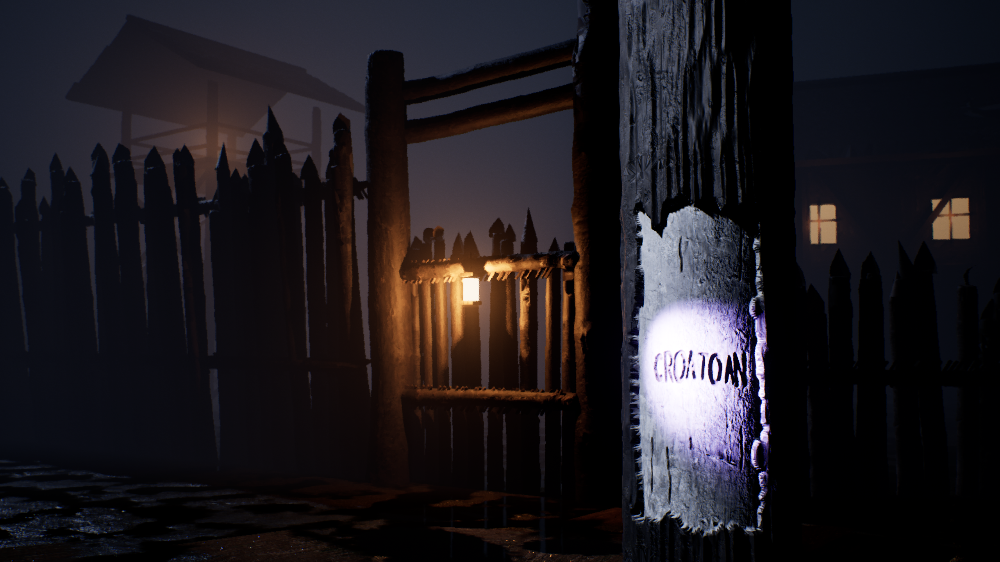

UV light off (test for H): the word still reads from the grooves alone, under the moon and the lantern.

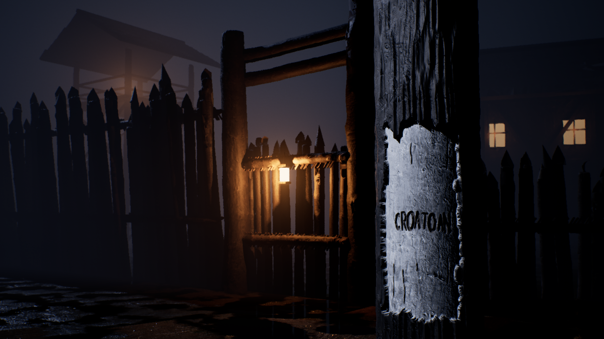

Changes from the round 2 review (exposure -0.5 EV):
- H/I. The CROATOAN post is now real geometry (`tools/make_panel_mask.ps1` writes the mesh), not a decal:
  - Dark, deeply furrowed bark all round the post.
  - One stripped panel, about 54 x 120 cm, centred at 1.5 m and sunk 2.5 cm below the bark, so the torn bark edge shows its thickness.
  - CROATOAN cut as V-grooves about 1.1 cm deep (letters 10 cm high, each one different), with darker raw wood inside the cuts. The letters carry no colour; they read from shadow.
  - The panel and bark share the log scan's grain strip, with no repeated tiles.
- J. UV beam: three overlapping soft lobes of different widths, slightly mis-aimed, so the pool has an uneven edge. It is held up and to the left, so it rakes across the grooves. An IES profile was tried but pointed off the light's axis in UE 5.8, so it is not used.
- K. Stakes are 20-32 cm and narrower at the point. Each point is 3-4 flat axe planes at random angles (`tools/make_hewn_tips.py`). The moon now comes from behind-left, so the stake edges pick up a rim.
- M. Mud varies at large scale, so the puddles no longer repeat as evenly. Hand-placed puddles on the approach catch the gate lantern, plus mud patches, two cart ruts and more stones.
- N. Tower: two storeys with X braces, a ladder, floor beams, a railed walk, a pitched shingle roof with 80 cm overhang and a dark underside, and a lantern. Set back in the fog.
- The house is pushed back and its windows toned down. A light haze returns with distance.

Assets: only the free Quixel Megascans already in the project (Fab Standard License, free for commercial use in Unreal): Old Wooden Log x2, Old Wooden Beam, Soil Mud, Military Trenches Ground Mud, Small Stones Pack, Scatter Rocks 03/06, plus grass and weeds. The post, stake points, tower and house are our own geometry.

Still to do (round 4):
1. L: Megascans bark, roof shingles and a timber-frame building would beat the hand-built tower roof and house. Adding them needs the project owner's Fab sign-in, so it is waiting on that.
2. The N of CROATOAN sits close to the panel's right edge. Give it a few more cm of margin.
3. At this distance the letters read a little thin. Cut them deeper and wider.
4. The tower roof still reads as a plain slab through the fog.
5. The far-left foreground mud still shows some repeat.
