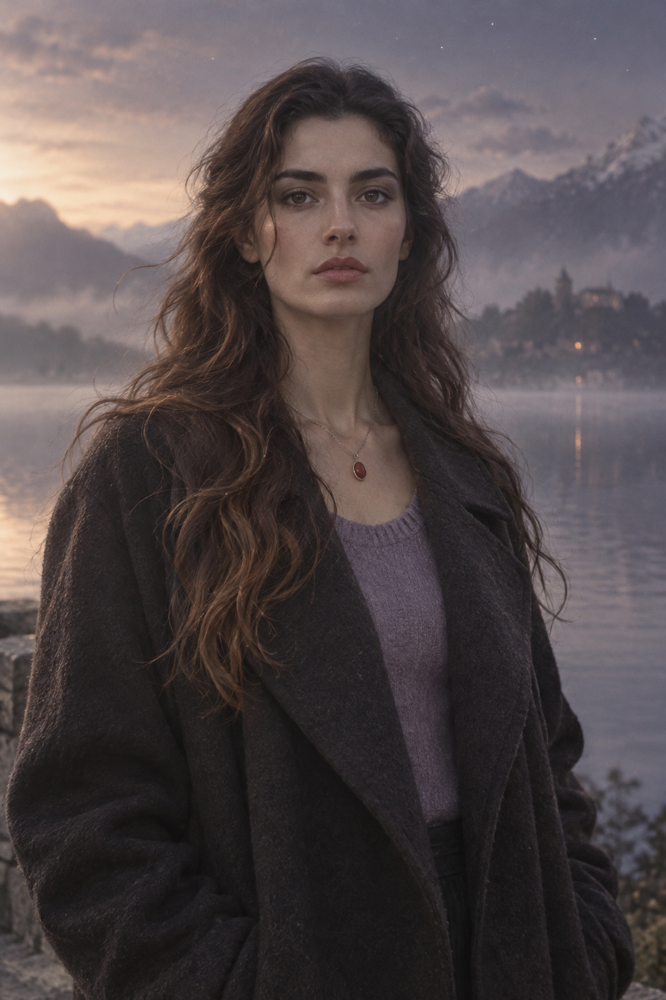
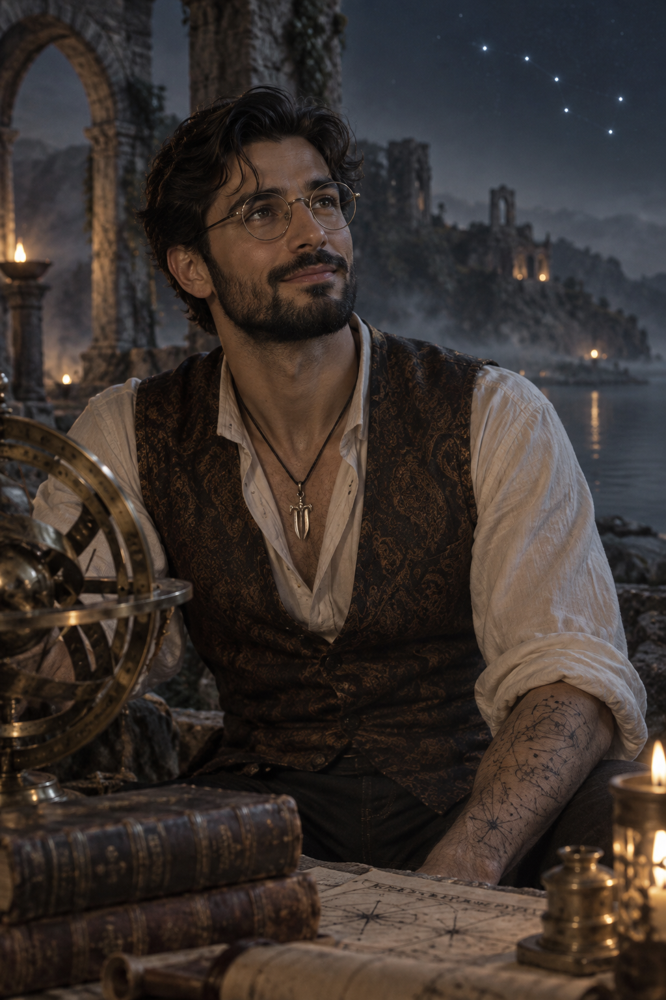
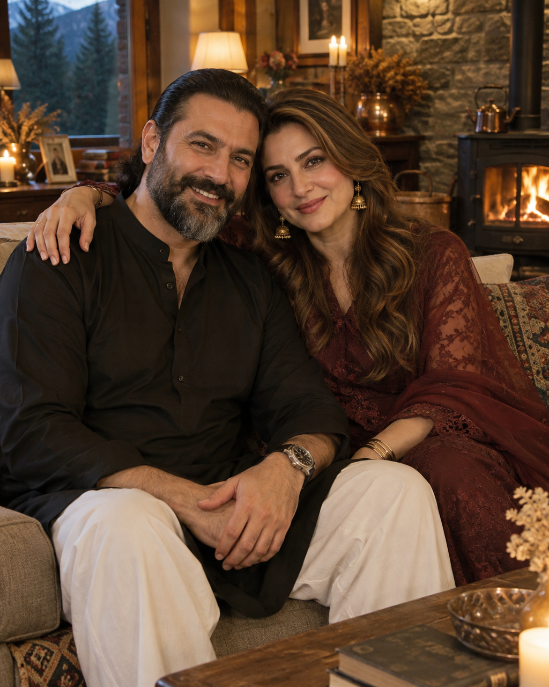

# LETHE · Locked Character Looks

**Status:** approved by Sydra on 27 October 2026. Use these for every scene picture and give them to the character artist.
Concept images were AI-generated (Figma, gpt-image model) for direction only. A human artist creates the final characters.

---

## Nysa Ali · 25 · NOW timeline (violet)

| | |
|---|---|
| **Build** | Tall and slender. |
| **Face** | Turkish/Anatolian features, fair luminous skin, a strong firm jaw, high cheekbones, straight nose, thick natural dark brows, full lips usually held in a calm line. |
| **Eyes** | Deep dark brown. A steady, direct gaze: she looks straight at you and seems to see past you. |
| **Hair** | Long and loose. Dark brown shading to light brown at the ends, soft waves and curls. |
| **Personality in her face** | Straightforward, observant, dreamy, unshakeable. |
| **Signature items** | Abbu's silver ring with a reddish carnelian (*aqeeq*) stone, worn on a thin chain at her collarbone. Lavender somewhere in every outfit. |
| **Reference outfit** | Long dark charcoal wool coat over a soft lavender knit. |
| **Her light** | Violet. |

## Eesa Ali · 29 · THEN timeline (blue)

| | |
|---|---|
| **Build** | Tall, lean, scholarly. Not heavy. |
| **Face** | Turkish features, fair light-olive skin (only a shade warmer than Nysa's), sculpted face, high cheekbones, firm jaw. A strong family resemblance to Nysa: same eyes, brows and jaw. Should read as late twenties, **not** older. |
| **Eyes** | Deep dark brown behind thin round gold wire glasses. Usually looking up and away, as if reading the stars. |
| **Hair and beard** | Thick wavy black hair swept back, loose strands over the forehead. A short, well-groomed full black beard. |
| **Expression** | A warm, knowing half-smile. Curious, kind, dreamy. |
| **Reference outfit** | Loose collarless cream linen shirt, sleeves rolled, under a fitted dark brown paisley brocade waistcoat. |
| **Skin details** | Hand-inked star maps and notes on his forearms: he writes what matters on his skin so Lethe can't take it. |
| **Signature item** | A small silver **Zulfiqar** pendant on a thin black cord (see below). |
| **His light** | Blue. |

### Zulfiqar pendant: exact design for the artist

The AI images do **not** show this correctly. Use this description:

- **Shape:** a sword seen flat, about 4 cm long, silver.
- **Blade:** broad and gently curved, widening toward the end.
- **Tip:** the defining feature. The blade **splits into two separate points** with a clear V-shaped gap between them, like a swallow's tail. The two prongs are roughly equal in length.
- **Hilt:** a short grip with a small crossguard whose ends curl slightly; a small round pommel with the loop for the cord.
- **Finish:** plain, slightly worn silver. No text, no gems.
- **Story rule:** it is personal jewellery only. It is never named on screen, never explained, and never used as a power. He wears it as a boy in 2011 too.

---

## The parents · Alex (Abbu) 55 and Syd (Ammi) 52, in 2026

Young, stylish and warm for their age. **Never** frail or elderly.

| | Alex (Abbu) | Syd (Ammi) |
|---|---|---|
| **Age** | 55 in 2026 · 39 in the 2010 lake photo | 52 in 2026 · 36 in the 2010 lake photo |
| **Look** | Tall, fair. Long black hair with a few silver strands, combed straight back and tied at the nape. Full, neatly groomed dark beard, a touch of grey at the chin. | Fair, glowing skin. Long loose wavy caramel-brown hair with lighter highlights. Defined brows, warm brown eyes. |
| **Expression** | A big, warm grin that creases his eyes. | A soft, affectionate smile; animated when she talks. |
| **Style** | Black kurta and white shalwar at home; leather jacket outdoors; steel wristwatch. | Elegant even at home: lace or embroidered outfits, sheer dupatta, gold jhumkas and thin gold bangles. A white chiffon prayer dupatta at dawn. |
| **Life** | Teacher, just given a university post in Islamabad. Drives an old white Corolla he refuses to sell. | Talks fast, always feeding someone. |

---

## The pair

- **Nysa:** dawn, mist, the lake above, violet and grey.
- **Eesa:** night, candlelight, ruins below, blue and warm gold.
- Side by side they should look like brother and sister about four years apart.
